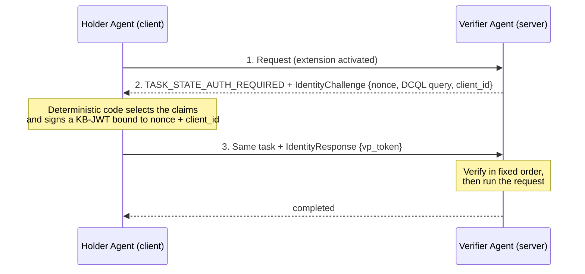
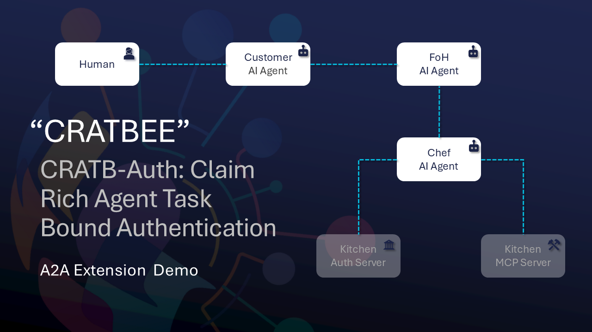

# CRATB-Auth: Claim Rich Agent Task Bound Authentication

**Nicknamed "cratbee".**

**Allowing agents to autonomously prove its identity within task.**

> **Status:** Draft v0.1 (latest revision v0.1.4, 2026-09-24; unreleased changes up to 2026-10-17, see the [changelog](spec/v0.1/extension.md#appendix-b-changelog))<br/>
> **Extension URI:** `https://github.com/a2aproject/experimental-ext-cratb-auth/tree/main/v1`<br/>
> **Specification:** [`spec/v0.1/extension.md`](spec/v0.1/extension.md)

This repository holds the specification of an A2A extension that lets one AI agent dynamically prove its identity to another. The called agent states which identity it requires at the moment of contact, and the calling agent answers with a selectively disclosable credential (SD-JWT). Both messages travel inside the A2A conversation, so trust is established in-band rather than through a separate, pre-defined authorization step.

This repository also contains a Python SDK and demos using the extension specification.

---

## Contents

1. [Why this extension exists](#why-this-extension-exists)
2. [How it works](#how-it-works)
3. [The specification](#the-specification)
4. [Reference implementations](#reference-implementations)
5. [Quick start](#quick-start)
7. [Where to go next](#where-to-go-next)

---

## Why this extension exists

AI agents now often work on their own. They call tools, use outside resources, and hand tasks to other agents, with no person approving each step. Current authorization methods, such as OAuth 2.0, assume that the access needed is known before the AI agent transacts.

This extension lets the called agent state which identity it requires at the moment of contact. The calling agent then answers with a verifiable credential. Both the request and the answer travel inside the A2A message itself, so the extension works with every A2A transport. For the full reasoning, read the draft paper [In-Band Agent Identity Verification for the A2A Protocol](https://www.overleaf.com/project/6a9ac8f3866c45d6495d08f3).

---

## How it works

A **Holder** agent (the A2A client) holds a credential signed by an **Issuer** and bound to the Holder's key. A **Verifier** agent (the A2A server) asks for proof before it does any work. The core handshake has three steps ([§7](spec/v0.1/extension.md#7-protocol-flow)):



1. **Challenge** ([§7.3.3](spec/v0.1/extension.md#733-identity-challenge)). The Verifier answers the first request (which carries no task id and states `A2A-Version: 1.0`) with the A2A v1.0.0 state `TASK_STATE_AUTH_REQUIRED` and a server-allocated task id, a fresh nonce, a DCQL query that names the required claims, and its own `client_id`.
2. **Response** ([§7.3.4](spec/v0.1/extension.md#734-identity-response)). The Holder discloses only the requested claims and signs a Key Binding JWT (KB-JWT) bound to that nonce and audience.
3. **Verification.** The Verifier checks issuer signature, expiry, revocation, key binding, nonce, and audience in a fixed order. Then it opens an *Authenticated Task Session* ([§5.5](spec/v0.1/extension.md#55-authenticated-task-session)), so later messages on the same task need no new proof.

Requests often pass through several agents. The extension supports both cases:

| | Single-hop | Multi-hop ([§12.6.1](spec/v0.1/extension.md#1261-delegated-challenge-tunneling-profile-multi-hop), Delegated Challenge Tunneling) |
|---|---|---|
| Who holds the credential | The Verifier's direct caller. | An agent further up the chain. |
| What the agent in the middle does | - | Wraps the challenge in `tunneled_challenge`, sends it to its caller, and forwards the answer unchanged. |
| KB-JWT audience | The Verifier. | The terminal Verifier, so the relay cannot reuse the presentation. |
| Who validates | The Verifier. | Only the terminal Verifier. |

More information in [docs/protocol-overview.md](docs/protocol-overview.md).

---

## The specification

[`spec/v0.1/extension.md`](spec/v0.1/extension.md) is the normative text: data structures, handshake, verification order, error codes, and security requirements.

---

## Reference implementations

The SDK and the demos implement the specification so that it can be evaluated. They are not production components.

```text
  spec/ -- defines --▶  sdk/python/ -- used by --▶  examples/
```

| Part | Path | Description |
|---|---|---|
| **SDK** | [`sdk/python/`](sdk/python/README.md) | A Python library (`a2a_agentic_id`) for issuing, holding, presenting, and verifying credentials on both sides of the handshake. |
| **Offline simulation** | [`examples/restaurant-simulation/`](examples/restaurant-simulation/README.md) | An in-process scenario covering every spec error code, revocation (Token Status List), chain of trust, payment commitments, the tunneling envelope, and the x401 profile. It includes unit, conformance, and integration tests. No network, LLM, or API keys needed. |
| **ADK demo** | [`examples/restaurant-adk/`](examples/restaurant-adk/README.md) | Three LLM-driven agents built on Google's Agent Development Kit (ADK), running as separate processes over real A2A, with a human in the loop, single-hop and multi-hop verification. |
| **Docs** | [`docs/`](docs/) | [Protocol overview](docs/protocol-overview.md), [glossary](docs/glossary.md), and the [demo flow](docs/demo-flow.md). |

Both demos use the same restaurant scenario: a customer agent orders through a front-of-house (FoH) agent, which passes the order to a chef agent, which uses a kitchen API. Each hop requires a credential. In the ADK demo, the kitchen runs out of an ingredient and the customer must approve a substitute. The approval becomes a signed credential that the chef verifies: the FoH agent tunnels the chef's challenge to the customer and forwards the answer unchanged. The stages are in [docs/demo-flow.md](docs/demo-flow.md).

[](docs/media/demo.mp4)

The ADK demo simplifies deployment (plain HTTP, short identifiers, local keys). Its full list of deviations from the specification is in [the ADK README](examples/restaurant-adk/README.md#deviations-and-open-points).

---

## Quick start

To see the specification in action, run the offline simulation and its conformance tests from the repository root:

```bash
python -m venv .venv
source .venv/bin/activate        # macOS / Linux
# .venv\Scripts\Activate.ps1     # Windows PowerShell

pip install -e "sdk/python[dev]"
python examples/restaurant-simulation/demo/run_simulation.py
pytest examples/restaurant-simulation/tests
```

To run the multi-agent ADK demo, follow [the ADK setup](examples/restaurant-adk/README.md#installation). To use the SDK in your own agents, start with [sdk/python/README.md](sdk/python/README.md).

---

## Where to go next

| If you want to… | Read |
|---|---|
| Review the protocol | [`spec/v0.1/extension.md`](spec/v0.1/extension.md) |
| Use the SDK | [sdk/python/README.md](sdk/python/README.md); the [simulation tests](examples/restaurant-simulation/tests/) are the most complete usage examples |
| Integrate with an agent framework | [ADK demo: how the code maps to the spec](examples/restaurant-adk/README.md#how-the-code-maps-to-the-spec) |
| Run the multi-agent demo | [examples/restaurant-adk/README.md](examples/restaurant-adk/README.md) |

<!-- TODO: Add contribution guidelines, an issue tracker, and a published package (e.g. PyPI) once they exist. -->
