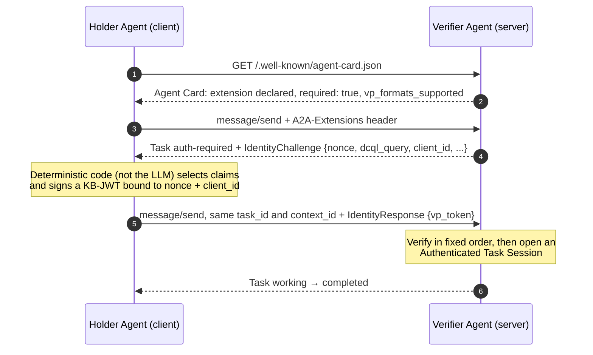

# Protocol overview

This page summarizes the CRATB-Auth: Claim Rich Agent Task Bound Authentication extension. The linked sections of [`spec/v0.1/extension.md`](../spec/v0.1/extension.md) are normative. For terms, see [glossary.md](glossary.md).

## Roles

| Role | A2A position | Responsibility |
|---|---|---|
| **Holder Agent** | Client | Holds a credential and its private key; answers challenges with a signed presentation. |
| **Verifier Agent** | Server | Declares the extension, issues challenges, and verifies presentations before doing any work. |
| **Intermediate Agent** | Client and server | Relays a downstream Verifier's challenge to the Holder and forwards the answer unchanged (§12.6.1). |
| **Issuer** | Outside the handshake | Signs credentials and binds each to a holder's public key. The root of trust. |
| **Status list service** | Outside the handshake (optional) | Publishes revocation status as an IETF Token Status List. |

An agent often plays both roles - Verifier toward its caller, Holder toward the next agent downstream.

## The credential

The core credential is the **`AIAgentIdentityCredential`** in `dc+sd-jwt` format (§5, §9). It is signed by a trusted issuer, bound to the holder's key through `cnf.jwk` (possession is proven with a Key Binding JWT at presentation time), selectively disclosable, and always tied to a responsible owner - a legal or natural person.

Its claims are `id` (always disclosed), `name`, `description`, `owner` (`id`, `name`, optional `type`), and the optional `status` and `key_protection_level` (`software`, `hardware_tee`, `hardware_hsm`).

The handshake is not limited to this type: the demos use the same flow for employee credentials, vouchers, and consent approvals.

## The handshake

| Step | What happens | Spec |
|---|---|---|
| Discovery | The Holder reads the Verifier's Agent Card to learn the extension URI and accepted formats. | §4, §7.3.1 |
| Initial Request | The Holder activates the extension with the `A2A-Extensions` header. | §6, §7.3.2 |
| Identity Challenge | The Verifier returns `auth-required` with a fresh nonce, a DCQL query naming the required claims, and its `client_id`. | §7.3.3, §8.1 |
| Identity Response | The Holder replies on the same `task_id` and `context_id` with a `vp_token`, keyed by the DCQL credential `id` read from the challenge. | §7.3.4, §8.2, §9.6.1 |
| Verification | The Verifier checks the presentation in a fixed order (below). | §7.3.4 |
| Completion | The Verifier opens an Authenticated Task Session and processes the request through `working` to `completed`. | §5.5, §7.3.5 |

## Single-hop and multi-hop

| | Single-hop | Multi-hop (Delegated Challenge Tunneling, §12.6.1) |
|---|---|---|
| Who is challenged | The Verifier's direct caller, which holds the credential. | An Intermediate Agent that does not hold the credential. |
| What the intermediate does | - | Wraps the challenge in `tunneled_challenge` with `origin_task_id` and sends it to its own caller. |
| KB-JWT audience | The direct caller's Verifier. | The terminal Verifier, not the relay. |
| Who validates | The Verifier. | Only the terminal Verifier; the relay forwards the `vp_token` unchanged. |

## Invariants

These are the properties to review, test, or preserve in any reimplementation:

- **Declaration gate.** The extension is declared `required: true`; a request without the `A2A-Extensions` header fails with `AUTH_EXTENSION_REQUIRED` (§6.2).
- **Mandatory baseline.** Every implementation supports `dc+sd-jwt` with `ES256` for both the SD-JWT and the KB-JWT (§4.1).
- **Fixed verification order** (§7.3.4, §13.1): issuer signature → expiry → revocation status (if a `status` claim is present) → KB-JWT signature against `cnf.jwk` → `nonce` → `aud` equals the Verifier's `client_id` → `conversation_id` (if present) → `domains` (if present) → `channel_binding` (if the Verifier declares it).
- **Nonce discipline.** Nonces have at least 128 bits of entropy, are stored per (`task_id`, `nonce`), and are consumed on first use whether verification succeeds or fails. Recommended lifetime: 5 minutes (§12.1, §12.5).
- **Authenticated Task Session.** Once a task passes verification, later messages on it need no new presentation. The session is discarded when the task reaches `completed`, `failed`, or `canceled` (§5.5).
- **Presentation scoping.** The optional KB-JWT claims `conversation_id` and `domains` narrow where a presentation can be replayed; when present, the Verifier must enforce them (§12.6).
- **No new A2A states.** The extension reuses `auth-required` and `failed`, signalling sub-states in `metadata[ext_uri].status` (§10).
- **Uniform errors.** Every failure is `TASK_STATE_FAILED` with one of 14 codes in `metadata[ext_uri].error` (§11).
- **Transport security.** All exchanges use TLS; mTLS is optional for high-assurance deployments (§7.2).
- **Data minimization.** Verifiers request only what their policy needs, and Holders disclose nothing beyond the DCQL query (§5.2, §12.7).

## Optional profiles

| Profile | Purpose | Spec |
|---|---|---|
| **Step-up challenge** | Mid-task request for an additional or different credential, with a new nonce on the same task. | §5.5 item 3 |
| **Channel binding** | The Verifier requires each KB-JWT to carry the RFC 9266 `tls-exporter` value of the TLS 1.3 connection that carries it, so a leaked presentation cannot be used over another connection. Not available for tunneled presentations. | §12.8 |
| **Delegated Challenge Tunneling** | An intermediate agent relays a downstream Verifier's challenge to the original Holder and relays the answer back without re-validating it; the KB-JWT stays bound to the terminal Verifier. | §12.6.1 |
| **x401 Token Exchange** | Exchange a presentation for an OAuth 2.0 bearer token (RFC 8693) to call a plain HTTP API, discovered through RFC 9728 Protected Resource Metadata. | Demo only (`restaurant_domain.x401`) |

> The extension URI is `https://github.com/a2aproject/experimental-ext-cratb-auth/tree/main/v1` (§2).

## Open points in the specification

- As §6 notes, no IETF-registered `subject_token_type` exists yet for verifiable presentations, so the demo-only x401 profile may not interoperate across issuers.
- The spec does not define when a Holder should answer a tunneled challenge (holder tunnel policy), or which `contextId` a KB-JWT's `conversation_id` should carry when the hops use different values.
