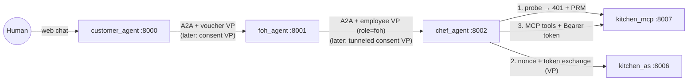

# Verifiable Credential Restaurant (ADK and A2A)

This project is a demonstration of agent identity verification. It uses the Python SDK (`sdk/python/`), which implements the CRATB-Auth: Claim Rich Agent Task Bound Authentication specification (`spec/v0.1/extension.md`).

Three autonomous agents communicate with the Agent2Agent (A2A) protocol. The agents complete a food voucher redemption. Each step requires a signed verifiable credential. The agents do not use unauthenticated requests.

For the protocol summary, see [`docs/protocol-overview.md`](../../docs/protocol-overview.md). For an offline version of the scenario with a conformance test suite, see [`examples/restaurant-simulation/`](../restaurant-simulation/README.md). Back to the [repository README](../../README.md).

## System Architecture

The demonstration uses five separate network processes:

| Process | Directory | Port | Function |
| :--- | :--- | :--- | :--- |
| `customer_agent` | `customer_app/` | 8000 | Communicates with the human user and `foh_agent`. |
| `foh_agent` | `foh_app/` | 8001 | Communicates with `customer_agent` and `chef_agent`. |
| `chef_agent` | `chef_app/` | 8002 | Communicates with `foh_agent` and Kitchen services. |
| `kitchen_as` | `kitchen_as/` | 8006 | Issues scoped access tokens through RFC 8693 token exchange. |
| `kitchen_mcp` | `kitchen_mcp/` | 8007 | MCP resource server for kitchen inventory and cooking tools. |

The communication path is fixed:
`Human` <-> `customer_agent` <-> `foh_agent` <-> `chef_agent` <-> `Kitchen API`

`chef_agent` cannot communicate with the human user directly. All services bind to `127.0.0.1`.



## The Kitchen: Authenticated Resource Server

The Kitchen (ingredients and cooking) is not an internal Python module inside `chef_agent`. It runs as two standalone network services:

| Process | Directory | Port | Role |
| :--- | :--- | :--- | :--- |
| `kitchen_as` | `kitchen_as/` | 8006 | x401 Authorization Server (RFC 8693 Token Exchange) |
| `kitchen_mcp` | `kitchen_mcp/` | 8007 | MCP resource server; the Kitchen API, bearer-token protected |

Before `chef_agent` can call a Kitchen tool, it discovers authentication requirements dynamically using RFC 9728 Protected Resource Metadata and the **demo-only x401 token exchange profile** (`restaurant_domain/x401.py`; not part of the extension spec):

1. `chef_agent` sends an unauthenticated request to `kitchen_mcp`. `kitchen_mcp` rejects the request with HTTP `401 Unauthorized`. The `WWW-Authenticate` header provides the Protected Resource Metadata (PRM) URL:
   `resource_metadata="http://127.0.0.1:8007/.well-known/oauth-protected-resource/mcp"`.
2. `chef_agent` retrieves that PRM document. The document identifies `kitchen_as` as the authorization server.
3. `chef_agent` retrieves metadata from `kitchen_as` (`GET /.well-known/oauth-authorization-server`). This metadata contains `nonce_endpoint`, `token_endpoint`, and `dcql_scope_mapping`. The mapping defines the DCQL query that a Verifiable Presentation (VP) must satisfy for each scope.
4. `chef_agent` requests a single-use nonce from `nonce_endpoint`. It generates an SD-JWT Verifiable Presentation of its `EmployeeCredential` bound to that nonce and the `kitchen_as` issuer URL. It packages this token as an x401 Result Artifact.
5. `chef_agent` exchanges the artifact at `token_endpoint` (RFC 8693 `grant_type=urn:ietf:params:oauth:grant-type:token-exchange`). `kitchen_as` validates the presentation and issues a Bearer token with the authorized scopes. For example, role `chef` receives `kitchen:enter` and `kitchen:appliances:use`. Role `foh` receives only `kitchen:enter`.
6. `chef_agent` calls `kitchen_mcp` tools (`list_ingredients`, `prepare_dish`) with the header `Authorization: Bearer <token>`. `kitchen_mcp` validates the signature, audience, and scopes for each call.

`common/kitchen_client.py` executes these steps and caches the access token until near expiration.

## Demonstration Stages

| Stage | Action | Description |
| :--- | :--- | :--- |
| 0 | Upload Voucher | The human user uploads a signed voucher file (`.jwt`) to the customer chat interface. |
| 1 | Start Redemption | `customer_agent` presents the voucher credential to `foh_agent`. `foh_agent` verifies the signature. |
| 2 | Kitchen Check | `foh_agent` forwards the order to `chef_agent`. `chef_agent` queries `kitchen_mcp` and detects a missing ingredient. |
| 3 | Substitution Proposal | `chef_agent` proposes a substitute ingredient. `foh_agent` relays the proposal to `customer_agent`. |
| 4 | Human Consent | The human user approves the substitute. `customer_agent` creates a signed consent credential. |
| 5 | Order Completion | `customer_agent` submits the consent credential. The agent set by `CONSENT_VERIFIER` verifies it. Then `chef_agent` completes the preparation. See [Consent Verification: Single Hop or Tunnel](#consent-verification-single-hop-or-tunnel). |

## Consent Verification: Single Hop or Tunnel

The `CONSENT_VERIFIER` environment variable selects the agent that verifies the customer's signed consent (`IngredientSubstitutionApproval`). Set it in `.env` for the `foh_app` and `chef_app` processes. Both processes must use the same value.

| Value | Verifier | Flow |
| :--- | :--- | :--- |
| `chef` (default) | `chef_agent` | Multi-hop. `foh_agent` tunnels the challenge (spec 12.6.1). |
| `foh` | `foh_agent` | Single hop. `foh_agent` tells `chef_agent` the result in plain text. |

The voucher is always verified single hop by `foh_agent`. The employee credential is always verified single hop by `chef_agent`.

### `CONSENT_VERIFIER=chef` (Delegated Challenge Tunneling)

`chef_agent` uses the ingredients, so `chef_agent` verifies the consent itself. It does not trust a text message from `foh_agent`.

1. `customer_agent` sends the consent message to `foh_agent`.
2. `foh_agent` calls `chef_agent` in the same `contextId`. `chef_agent` issues a step-up challenge with `client_id=chef_agent` and a new nonce.
3. The challenge asks for `sub_approval`. The `foh_agent` wallet does not hold it. `foh_agent` does not answer the challenge (Rule 5). It wraps the challenge in `tunneled_challenge` with `origin_task_id` set to the chef task ID (Rule 1).
4. `customer_agent` checks its tunnel policy. It answers only challenges from `chef_agent` for `sub_approval`. It binds the KB-JWT to `aud=chef_agent` and the chef nonce (Rule 2). It sends the result in `tunneled_response` (Rule 3).
5. `foh_agent` matches `origin_task_id` to its pending tunnel. It forwards the `vp_token` to `chef_agent` unchanged. It does not validate the `vp_token` (Rule 4).
6. `chef_agent` verifies the issuer signature, the KB-JWT, the nonce, and the audience. It also compares `order_id`, `original_ingredient`, and `substitute_ingredient` with the pending order. Then it prepares the dish.

In this mode, `foh_agent` does not trust the customer as a credential issuer.

### Reading the Logs

Each credential exchange has a colored tag in the terminal logs. The tag shows the hop type and the step number. Use the step number to follow one exchange across the terminals of all agents. Each exchange starts with a banner that shows the route and the reason for the hop type.

| Tag | Meaning |
|---|---|
| `[SINGLE-HOP 1/3]` | The verifier sends a challenge to its direct caller. |
| `[SINGLE-HOP 2/3]` | The caller sends its own presentation (`vp_token`). |
| `[SINGLE-HOP 3/3]` | The verifier shows the result. |
| `[MULTI-HOP 1/5]` | The verifier sends a challenge to the relay. The relay does not hold the credential. |
| `[MULTI-HOP 2/5]` | The relay sends a `tunneled_challenge` to the holder. |
| `[MULTI-HOP 3/5]` | The holder checks its policy, binds the KB-JWT to the verifier, and sends a `tunneled_response` to the relay. |
| `[MULTI-HOP 4/5]` | The relay forwards the `vp_token` unchanged. It does not validate it. |
| `[MULTI-HOP 5/5]` | The verifier validates the presentation and shows the result. |

The voucher (stage 3) and the employee credential (stage 4) always use `SINGLE-HOP`. The consent (stage 5) uses `MULTI-HOP` if `CONSENT_VERIFIER=chef`, and `SINGLE-HOP` if `CONSENT_VERIFIER=foh`.

### Deviations and Open Points

The demo is a reference for evaluating the draft spec, not a production deployment. It differs from the spec in these points:

- **Transport.** Services use plain HTTP on `127.0.0.1`. The spec requires TLS (spec 7.2).
- **Identifiers.** `client_id` and `iss` are short names such as `foh_agent` and `restaurant_issuer`. The spec requires canonical URLs (spec 13.1).
- **Issuer keys.** Issuer public keys come from the local `keys/` directory, not from issuer JWKS endpoints (spec 5.4).
- **Extension activation.** The Verifier gate treats the extension as active when its metadata is in the message. It does not read the `A2A-Extensions` HTTP header (spec 6).
- **Key storage.** Private keys are plain JWK files. This is equal to `key_protection_level: software`.
- **Kitchen tokens.** `kitchen_as` signs access tokens with a shared HS256 development secret.
- **Revocation.** The demo does not use the Token Status List. The offline simulation covers it.
- **`CONSENT_VERIFIER=foh`.** `chef_agent` completes the substituted order because `foh_agent` says that the consent is verified. `chef_agent` does not check the consent credential. This is similar to an Attesting Proxy model, which the spec does not define (spec 12.6.1). The default, `CONSENT_VERIFIER=chef`, does not have this problem.
- **Metadata location.** The demo sends extension metadata in part metadata. The spec puts it in `message.metadata`.
- **Holder tunnel policy.** The spec does not define rules for when a holder answers a tunneled challenge. The demo adds an allowlist (`TunnelPolicy` in `common/a2a_caller.py`).
- **`conversation_id` across hops.** The demo uses one `contextId` for all hops, so the KB-JWT `conversation_id` agrees at `chef_agent`. The spec does not say which `contextId` to use when the hops have different values.
- **Channel binding.** The demo runs over plain HTTP, so it cannot bind presentations to a TLS connection (spec 12.8). Its Agent Cards do not declare `channel_binding`, and the session binding of spec 5.5 is disabled (`require_channel_binding=False` in `common/identity_gate.py`).
- **Nonce expiry.** The SDK does not enforce a nonce lifetime (spec 12.5). A nonce stays valid until it is used or the task session closes.
- **Intermediate helper.** The SDK has no helper for the Intermediate Agent role. The demo adds `tunnel_upstream` and `take_tunneled_response` in `common/identity_gate.py`.
- **Wallet matching.** The SDK wallet now requires an exact DCQL credential ID match. Before, it could present a different credential of the same format.

<!-- TODO: Confirm whether any of these simplifications are planned to change (TLS, JWKS resolution, metadata location), and link the relevant issues or roadmap. -->

## Prerequisites

Before setup, verify that:

1. Python 3.12 or later is installed.
2. You have access to a LiteLLM proxy endpoint, an API key, and a model name.
3. The credential SDK is available at `sdk/python/` in the repository root.
4. Local ports 8000–8002, 8006, and 8007 are free, and you can open five terminals.

The agents use the model for reasoning only. Identity checks never use the model.

<!-- TODO: State which models were tested. The code defaults to LITELLM_PROXY_MODEL=gemini-3.8-flash when unset; please confirm this model name. Also state whether direct Gemini API or Vertex AI access, without a LiteLLM proxy, is supported. -->

## Installation

Complete these steps in order:

1. Open a terminal in the project directory:
   ```bash
   cd examples/restaurant-adk
   ```

2. Install the SDK and the required Python packages:
   ```bash
   pip install -e ../../sdk/python
   pip install google-adk a2a-sdk litellm httpx pyjwt cryptography pydantic mcp starlette uvicorn
   ```
   The SDK install is optional. If the SDK is not installed, `common/__init__.py` adds `sdk/python` to the import path.

   <!-- TODO: Provide pinned or minimum versions (ideally a requirements.txt) for google-adk and a2a-sdk. The code uses the protobuf-based a2a-sdk API (a2a.types.a2a_pb2) and needs a local protobuf patch (common/protobuf_patch.py), so it is likely version-sensitive. -->

3. Create a `.env` file in `examples/restaurant-adk/` with your LiteLLM settings:
   ```ini
   LITELLM_PROXY_BASE_URL=<your LiteLLM proxy URL>
   LITELLM_PROXY_API_KEY=<your LiteLLM proxy API key>
   LITELLM_PROXY_MODEL=<your model name>
   ```

   The ADK web server reads `.env` when it loads an agent. The kitchen services do not need it.

   <!-- TODO: Confirm that the ADK CLI loads .env automatically; nothing in the demo code calls load_dotenv. -->

   Optional variables:

   | Variable | Default | Effect |
   |---|---|---|
   | `CUSTOMER_MODEL`, `FOH_MODEL`, `CHEF_MODEL` | `LITELLM_PROXY_MODEL` | Sets a different model for one agent. |
   | `CONSENT_VERIFIER` | `chef` | Selects the agent that verifies the consent: `chef` (multi-hop) or `foh` (single hop). `foh_app` and `chef_app` must use the same value. |
   | `KITCHEN_AS_JWT_SECRET` | `dev-only-kitchen-as-secret-change-me` | HMAC secret of `kitchen_as` and `kitchen_mcp`. Set the same value for both. |
   | `A2A_CALL_TIMEOUT_SECONDS` | `180.0` | HTTP timeout for calls between agents. |
   | `SUPPRESS_EXPERIMENTAL_WARNINGS` | on | Set to `0`, or use `--show-warnings`, to show ADK experimental-feature warnings. |

4. Generate the cryptographic keys and credentials:
   ```bash
   python -m common.bootstrap_keys
   ```
   This command creates key pairs for two issuers and three agents, an `EmployeeCredential` for each staff agent (roles `foh` and `chef`), and the customer voucher `vouchers/grilled-cheese.jwt`.

   Do not run `bootstrap_keys` again unless you remove the existing `keys/` and `vouchers/` directories first.

## How to Start the Services

Start each service in a separate terminal in this order:

1. **Kitchen MCP Server:**
   ```bash
   python -m kitchen_mcp
   ```

2. **Kitchen Authorization Server:**
   ```bash
   python -m kitchen_as
   ```

3. **Chef Agent:**
   ```bash
   python run_adk.py web chef_app --port 8002 --a2a
   ```

4. **Front-of-House Agent:**
   ```bash
   python run_adk.py web foh_app --port 8001 --a2a
   ```

5. **Customer Agent:**
   ```bash
   python run_adk.py web customer_app --port 8000
   ```
   Note: `customer_app` does not use the `--a2a` flag because other agents do not initiate calls to it.

6. Open `http://127.0.0.1:8000` in your web browser to access the customer chat interface.

The kitchen services show a banner with their endpoints. `kitchen_mcp` lists the tools `list_ingredients` and `prepare_dish`. `kitchen_as` lists the scopes `kitchen:enter` and `kitchen:appliances:use`.

The `--a2a` flag publishes an agent as an A2A server with its Agent Card (`chef_app/agent.json`, `foh_app/agent.json`). The Agent Card declares the extension with `required: true`. `run_adk.py` wraps the ADK CLI. It applies a protobuf patch, adds the agent label (for example `[CHEF_AGENT]`) to each log line, and removes LiteLLM noise.

## How to Run the Demonstration

Follow these steps in the web chat window (`http://127.0.0.1:8000`):

1. Upload the voucher file: `vouchers/grilled-cheese.jwt`.
2. Confirm that the agent displays the voucher entitlement and dietary claim.
3. Send a message to redeem the voucher.
4. Observe the `chef_agent` terminal. It displays the missing ingredient and the proposed substitute.
5. Review the proposed substitute in the customer chat window. Approve or reject it using the UI confirmation widget. Do not type your answer as text.
6. When approved, confirm that `customer_agent` reports the completed order.

### Walkthrough with Logs

Protocol events are logged as `HH:MM:SS.mmm [component] message`, with `->` for outgoing and `<-` for incoming messages. Nonces and IDs are truncated. See [Reading the Logs](#reading-the-logs) for the hop tags. Your timestamps and values will be different.

**1. Upload the voucher.** `customer_agent` reads the voucher from the uploaded file and checks it locally: issuer, signature, expiry, credential type, holder key, and disclosure digests. A file that fails a check is rejected at upload.

```text
[customer_agent] verifying voucher 'grilled-cheese.jwt': checking issuer signature, holder key and disclosures
[customer_agent] voucher verified: issuer='voucher_issuer', entitlement='Grilled Cheese', dietary='gluten-free' -> asking user for confirmation
```

**2. Confirm the redemption.** `customer_agent` is the Holder and `foh_agent` is the Verifier:

```text
[foh_agent] [SINGLE-HOP 1/3] OpenID4VP: unauthenticated request from customer_agent -> issuing challenge
[customer_agent] [SINGLE-HOP 1/3] <- [foh_agent]: OpenID4VP challenge: nonce=… aud=foh_agent DCQL=[voucher: [entitlement, dietary]]
[customer_agent] [SINGLE-HOP 2/3] OpenID4VP: matched DCQL -> creating SD-JWT VP token (voucher) bound to nonce=… aud=foh_agent
[foh_agent] [SINGLE-HOP 3/3] RESULT: VERIFIED -> 'RestaurantVoucher' (entitlement='Grilled Cheese', dietary='gluten-free')
[foh_agent] [SINGLE-HOP 3/3] authenticated task session opened: task_id=…
```

**3. `foh_agent` sends the order to `chef_agent`.** `foh_agent` is now the Holder and presents its employee credential. `chef_agent` accepts only `role = foh`:

```text
[chef_agent] [SINGLE-HOP 3/3] RESULT: VERIFIED -> 'EmployeeCredential' (role='foh')
```

**4. `chef_agent` gets a kitchen token through x401.** See [The Kitchen](#the-kitchen-authenticated-resource-server):

```text
[chef_agent] <- [kitchen_mcp]: 401, PRM at http://127.0.0.1:8007/…
[kitchen_as] scope 'kitchen:enter': DCQL satisfied -> GRANTED
[kitchen_as] token issued: sub=… scope=…
[kitchen_mcp] verify_token OK sub=… scopes=[…]
[kitchen_mcp] tool invoked: [list_ingredients] by client=…
```

The kitchen starts with no `gluten_free_bread`, so `chef_agent` proposes `gluten_free_tortilla`. The proposal goes back through `foh_agent` to `customer_agent`.

**5. Approve the substitution.** Use the confirmation widget. `customer_agent` creates the signed consent credential (`IngredientSubstitutionApproval`) only from the widget result, so the human makes the decision, not the model.

**6. The consent is verified by step-up.** With the default `CONSENT_VERIFIER=chef`:

```text
[chef_agent] [MULTI-HOP 1/5] -> [foh_agent]: OpenID4VP step-up challenge: nonce=… aud=chef_agent DCQL=[sub_approval: [order_id, original_ingredient, substitute_ingredient]]
[foh_agent] [MULTI-HOP 2/5] -> [customer_agent]: tunneled_challenge (12.6.1 Rule 1): the challenge of 'chef_agent', unchanged. origin_task_id=… nonce=… aud=chef_agent …
[customer_agent] [MULTI-HOP 3/5] holder policy accepts: verifier 'chef_agent' and the requested credentials are allowed
[customer_agent] [MULTI-HOP 3/5] OpenID4VP: binding KB-JWT to terminal verifier aud='chef_agent', not to relay 'foh_agent' (12.6.1 Rule 2). The relay cannot reuse it.
[foh_agent] [MULTI-HOP 4/5] -> [chef_agent]: forward holder's vp_token unchanged (12.6.1 Rule 4): credentials=['sub_approval']. chef_agent validates it.
[chef_agent] [MULTI-HOP 5/5] RESULT: VERIFIED -> 'IngredientSubstitutionApproval' from customer_agent (original_ingredient='gluten_free_bread', substitute_ingredient='gluten_free_tortilla')
[chef_agent] [MULTI-HOP 5/5] consent agrees with the pending order (order_id, gluten_free_bread -> gluten_free_tortilla). …
```

With `CONSENT_VERIFIER=foh`, the consent is a `SINGLE-HOP` exchange between `customer_agent` and `foh_agent`. Then `foh_agent` tells `chef_agent` the result in plain text.

**7. The order completes.** `chef_agent` prepares the dish with the substitute. The chat shows the completed order.

```text
[kitchen_mcp] tool completed: [prepare_dish] dish='Grilled Cheese' with ingredients=[…'gluten_free_tortilla'…] -> status=…
```

<!-- TODO: Replace these excerpts with a transcript captured from a real run, and confirm the final chat message. They are derived from the log statements in the code; the ADK demo was not run while writing this document because it requires LLM credentials. -->

### Offline Smoke Test

You can run the credential exchanges without the servers or a model. A fake transport replaces HTTP. The script prints the normalized logs of all agents:

```bash
python tests/smoke_hops.py chef   # MULTI-HOP: chef_agent verifies the consent through foh_agent
python tests/smoke_hops.py foh    # SINGLE-HOP: foh_agent verifies the consent
```

Run `python -m common.bootstrap_keys` first.

## How to Modify Files During Execution

To apply code changes:

1. Stop the target process.
2. Restart the process with its original startup command.
3. Do not use the `--reload` flag on Windows. The ADK web server does not support automatic reloading on Windows in this configuration.

## Troubleshooting

- **Reset the kitchen.** The kitchen inventory is in memory. Restart `kitchen_mcp` to reset it.
- **Find identity failures.** The *Verifier* logs each failure in a line that contains `RESULT: REJECTED` or `FAILED`, with the spec error code (for example `VP_NONCE_MISMATCH` or `VP_DCQL_UNSATISFIED`).
- **Test without a model.** Use the [Offline Smoke Test](#offline-smoke-test).
- **New keys.** If you run `bootstrap_keys` again without removing `keys/` and `vouchers/`, the new keys do not agree with the credentials that you issued before.

## Project Structure

```text
examples/restaurant-adk/
├── customer_app/     customer_agent — communicates with the human user
├── foh_app/          foh_agent — verifies vouchers and routes orders
├── chef_app/         chef_agent — verifies staff credentials and prepares orders
├── kitchen_as/       x401 Authorization Server (RFC 8693 Token Exchange), port 8006
├── kitchen_mcp/      MCP resource server for Kitchen API, port 8007
├── common/           Shared utilities: identity, keys, A2A transport, kitchen client
├── tests/            Offline smoke test of the credential exchanges (smoke_hops.py)
├── keys/             Generated cryptographic keys and credentials (gitignored)
├── vouchers/         Generated demonstration vouchers (gitignored)
├── run_adk.py        Process launcher script
└── .env              Environment settings (gitignored)
```

## Architecture Summary

- **Standard A2A Protocol:** Inter-agent communication uses genuine A2A protocol messages without internal HTTP shims.
- **Cryptographic Verification:** Every request requires a valid credential. The customer presents a voucher credential; staff agents present employee credentials.
- **Verifiable Consent:** Approval of a substitute ingredient generates a signed credential (`IngredientSubstitutionApproval`). This credential provides non-repudiable consent.
- **Independent Authorization:** `kitchen_as` grants access tokens only after validating verifiable credentials against published DCQL queries.

## How the Code Maps to the Spec

| In the demo… | …this code runs… | …implementing this part of the spec |
|---|---|---|
| `customer_agent` fetches the FoH Agent Card and refuses to proceed if the extension is not declared | `common/a2a_caller.py` (`_get_client`) | Discovery and declaration (§4, §7.3.1) |
| `foh_agent` returns a challenge before its LLM sees the message | `common/identity_gate.py` `IdentityGate`, registered as ADK `before_agent_callback`, calling `ServerAuthRequiredInterceptor.process_incoming_request` | Enforced ordering; challenge issuing (§7.3.2–§7.3.3) |
| `customer_agent` presents only `entitlement` and `dietary` | `SDJWTWallet.create_vp_token`, called from tool code; the model never handles the private key | Unforgeability; selective disclosure and KB-JWT (§9.5, §9.6) |
| The KB-JWT carries `conversation_id` equal to the transaction's context ID | `call_with_identity(..., conversation_id=context_id)` | Conversation binding (§12.6) |
| FoH accepts the voucher, and later messages in the task need no new presentation | `SDJWTVerifier.verify_presentation`, then the interceptor's `authenticated_tasks` | Verification order (§7.3.4); Authenticated Task Session (§5.5) |
| `chef_agent` accepts only an employee credential with `role = foh` | DCQL query with `values=["foh"]` in `chef_app/agent.py` | DCQL value constraints (§9.6) |
| `chef_agent` obtains a kitchen token by presenting its credential | `common/kitchen_client.py` with `restaurant_domain.x401`; `kitchen_as` maps each scope to a DCQL query | x401 Token Exchange (demo-only; `restaurant_domain.x401`) |
| The chef (or FoH) requests signed consent mid-task | `IdentityGate.step_up`, which wraps the interceptor's `issue_step_up_challenge` and `verify_step_up_response` | Step-up; composite (`task_id`, `nonce`) store (§5.5, §12.1) |
| FoH relays the chef's consent challenge to the customer and forwards the answer unchanged | `tunnel_upstream` and `take_tunneled_response` in `common/identity_gate.py`; `call_with_identity(..., can_tunnel=True)` | Delegated Challenge Tunneling (§12.6.1) |
| The customer answers a relayed challenge only from `chef_agent`, only for the consent | `TunnelPolicy` in `common/a2a_caller.py` | Holder-side tunnel policy (demo-specific; the spec does not define one) |
| The human's approval becomes a signed credential | `SubstitutionIssuer.issue_approval_credential` | Holder-issued domain credential (demo-specific) |

The offline simulation covers what this demo does not: revocation through the Token Status List (§7.3.4), chain-of-trust verification (restaurant authority → restaurant → employee), holder-signed payment commitments, and a conformance test for every error code in §11.1.
