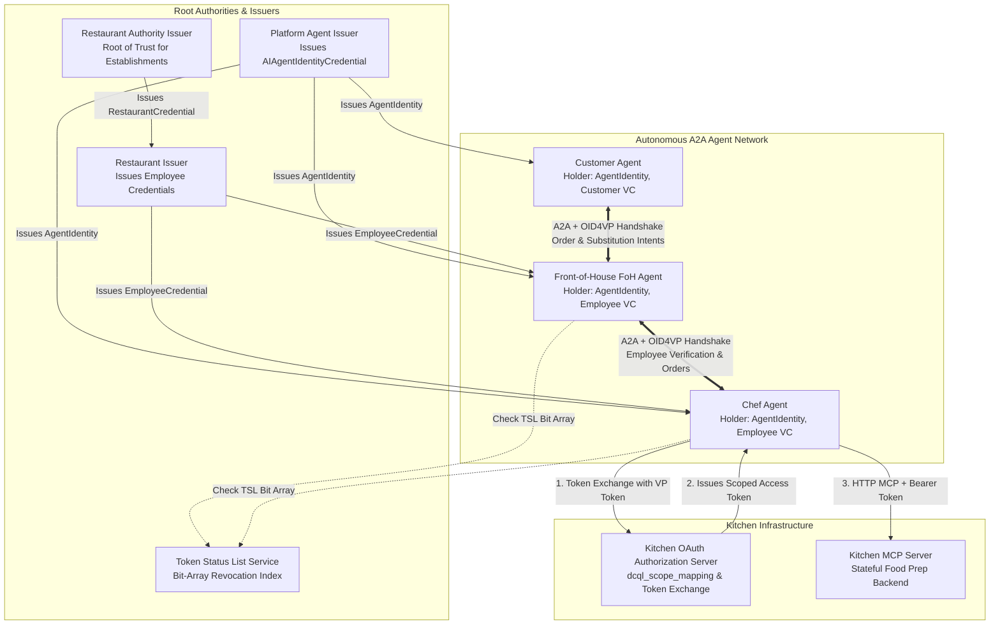

# Verifiable Credential Restaurant
**A Reference Implementation & Simulation Testbed for CRATB-Auth: Claim Rich Agent Task Bound Authentication (`v0.1`, `dc+sd-jwt`)**

---

## 1. Executive Summary & Architectural Overview

The **Verifiable Credential Restaurant** is an autonomous multi-agent simulation jointly developed by **Google and Thales**. It serves as a reference implementation, educational demonstration, and research testbed for **CRATB-Auth (v0.1)**.

The project models a realistic dining establishment hierarchy—comprising **Root Authorities**, **Enterprise Issuers**, **Waitstaff & Chef Agents**, **Autonomous Dining Customers**, and **Kitchen MCP Services**—to prove how **OpenID for Verifiable Presentations (OID4VP)** can be executed in-band over the **Agent-to-Agent (A2A)** protocol to solve complex enterprise security challenges:
- **Selective Disclosure (`dc+sd-jwt`)**: Disclosing minimum necessary claims while keeping identifiers and sensitive fields protected.
- **Holder Binding (Key Binding JWTs / KB-JWT)**: Proving possession of an EC P-256 private key (`cnf.jwk`) bound to specific task nonces and verifier audiences (`client_id`).
- **Transitive Trust Hierarchy**: Verifying waitstaff credentials across multi-hop organizational boundaries (`Employee -> Restaurant -> Authority`).
- **Instant Revocation**: Validating credential status against an **IETF Token Status List (`draft-ietf-oauth-status-list`)** bit-array.
- **Dynamic On-Demand Issuance**: Issuing verifiable, non-repudiable customer approval credentials during live task negotiation.



---

## 2. Core User Journey (CUJ) Protocol Mapping

| CUJ | Description | Participating Actors | Credential / Artifact | Protocol Mechanism | Validation & Cryptographic Invariant |
| :--- | :--- | :--- | :--- | :--- | :--- |
| **CUJ 1** | Hold a verifiable credential capturing agent identity | `Customer`, `FoH`, `Chef` | `AIAgentIdentityCredential` (`dc+sd-jwt`) | OID4VCI Pre-Authorized Code Flow | Holder binding (`cnf.jwk` EC P-256), Issuer JWKS signature verification. |
| **CUJ 2** | Check compatible VC formats prior to A2A request | Client -> Server | Agent Card (`params.vp_formats_supported`) | A2A Discovery (`/.well-known/agent-card.json`) | Enforces support for `dc+sd-jwt` and `ES256` signing algorithms. |
| **CUJ 3** | Establish mutual identities via A2A interaction | `Customer` <-> `FoH`<br/>`FoH` <-> `Chef` | `AIAgentIdentityCredential`, `EmployeeCredential` | In-band A2A `AUTH_REQUIRED` -> `IdentityChallenge` / `IdentityResponse` | KB-JWT verification (`nonce`, `aud`=`client_id`, `sd_hash`, `exp`, `cnf.jwk`). |
| **CUJ 4** | Authenticate to HTTP API using agent identity | `Chef` -> `Kitchen AS` -> `Kitchen MCP` | `EmployeeCredential` -> Bearer Access Token | OAuth 2.0 Token Exchange (`dcql_scope_mapping`) | AS validates SD-JWT VP and issues short-lived JWT Bearer access token with scopes. |
| **CUJ 5** | Request additional credentials during processing (Step-Up) | `Chef` -> `FoH` -> `Customer` | `OrderPaymentCommitment`, `SubstitutionApproval` | Dynamic A2A `TASK_STATE_AUTH_REQUIRED` step-up challenge during task execution (Spec 5.5 item 3), reusing `task_id`/`context_id` | Step-up DCQL query targeting specific order or substitution capabilities; the step-up nonce is tracked alongside, not in place of, the task's existing Authenticated Task Session (Spec 12.1). |
| **CUJ 6** | Verify credential through a chain of trust | `Customer` -> `FoH` (`Employee` -> `Restaurant` -> `Authority`) | `EmployeeCredential` + `VerifiedRestaurantCredential` | Chain-of-Trust verification via root JWKS resolution | Transitive trust: Root Authority signature -> Restaurant key -> Employee VC. |
| **CUJ 7** | Pass-through VC requests over a chain of A2A requests | `Chef` -> `FoH` -> `Customer` | Multi-hop DCQL challenge forwarding | A2A `metadata[ext_uri]` challenge tunneling via `context_id` preservation | Ensures `nonce` and `aud` are properly bound across multi-agent delegation hops. |
| **CUJ 8** | Determine that a VC has been revoked | Verifying Agent -> `TSL Service` | Token Status List JWT (`status.status_list`) | IETF Token Status List (`draft-ietf-oauth-status-list`) bit-array lookup | Byte-level bit inspection of issuer status list JWT. |

---

## 3. What Was Achieved Across Stages 1–5

### Stage 1: Virtual Chef & Kitchen API (OAuth Token Exchange)
- **What Was Built**:
  - `KitchenMCPServer`: Stateful Python HTTP MCP server managing inventory (`cheese`, `gluten_free_bread`, `butter`, etc.) and appliance states (`oven`, `griddle`). Protects tools with role-based JWT Bearer scope guards (`kitchen:enter`, `kitchen:appliances:use`).
  - `KitchenOAuthAS`: OAuth 2.0 Authorization Server supporting `.well-known/oauth-authorization-server` with `dcql_scope_mapping` and `/token/exchange`.
- **What Was Achieved**: Solved **CUJ 4** by allowing the Chef Agent to present its `RestaurantEmployeeCredential` as an OID4VP `vp_token` in exchange for a short-lived scoped Bearer token to execute Kitchen MCP commands.

### Stage 2: FoH / Chef Mediation & Employee Authorization
- **What Was Built**:
  - `RestaurantIssuerService`: Enterprise issuer generating `RestaurantEmployeeCredential` SD-JWTs with role claims (`"foh"` or `"chef"`) and Token Status List references (`status.status_list`).
  - `TokenStatusListClient`: Real-time IETF bit-array revocation checker.
  - `ChefAgent` & `FoHAgent`: A2A Server and Client equipped with `ServerAuthRequiredInterceptor` and `ClientAuthHandler`.
- **What Was Achieved**: Solved **CUJ 3 & CUJ 8**. When `FoHAgent` sends an order to `ChefAgent`, `ChefAgent` returns `TASK_STATE_AUTH_REQUIRED` with an `IdentityChallenge`. `FoHAgent` automatically generates a valid `vp_token` with an ES256 Key Binding JWT. `ChefAgent` validates the presentation and checks bit `idx` in the TSL bit-array, rejecting revoked credentials immediately.

### Stage 3: Autonomous Customers & Chain-of-Trust Verification
- **What Was Built**:
  - `RestaurantAuthorityIssuerService`: Root authority issuing `VerifiedRestaurantCredential` SD-JWTs to approved establishments, binding the restaurant's public key in `cnf.jwk`.
  - `CustomerAgent`: Autonomous dining agent with dietary and budget rules, equipped with transitive chain-of-trust verification.
- **What Was Achieved**: Solved **CUJ 6 & CUJ 7**. Before placing an order, `CustomerAgent` asks `FoHAgent` for restaurant legitimacy proof. `FoHAgent` presents both its `EmployeeCredential` and the restaurant's `VerifiedRestaurantCredential`. `CustomerAgent` verifies that the employee VC is signed by the restaurant key, and that the restaurant key is signed by the root `Restaurant Authority`.

### Stage 4: Order Management & Holder-Signed Payment Commitments
- **What Was Built**:
  - `OrderState` machine in `FoHAgent` tracking order progression (`CREATED` -> `CONFIRMED` -> `PREPARING` -> `SERVED` -> `PAID`).
  - `OrderCommitmentSigner` in `restaurant_domain` (demo package, not the core SDK) and `create_signed_payment_commitment` in `CustomerAgent`.
- **What Was Achieved**: Solved cryptographic domain artifact signing. `CustomerAgent` uses its holder private key (`cnf.jwk`) to sign an `OrderPaymentCommitment` ($15.00) as a compact JWS (`typ='order-commitment+jwt'`). `ChefAgent` verifies this signature against the customer's public key before cooking.

### Stage 5: Expanded Kitchen Dynamics & Dynamic VC Issuance
- **What Was Built**:
  - Inventory depletion simulation in `KitchenMCPServer` (triggering HTTP 409 Out of Stock on `"gluten_free_bread"`).
  - Dynamic SD-JWT issuance engine (`SubstitutionIssuer` & `IngredientSubstitutionApproval`, in `restaurant_domain`) in `CustomerAgent`.
- **What Was Achieved**: Solved **CUJ 5 & CUJ 7** for dynamic authorization. When `ChefAgent` encounters a depleted ingredient, it issues a fresh step-up `TASK_STATE_AUTH_REQUIRED` challenge (Spec 5.5 item 3, via `ServerAuthRequiredInterceptor.issue_step_up_challenge`) asking for an `IngredientSubstitutionApproval` credential, without disturbing its already-authenticated employee session for the task. `FoHAgent` tunnels this challenge to `CustomerAgent`. `CustomerAgent` checks dietary rules, dynamically issues and signs an approval SD-JWT authorizing `"gluten_free_tortilla"` as a substitute, and `ChefAgent` verifies it against that same step-up nonce (via `verify_step_up_response`) and successfully cooks `"Grilled Cheese (GF Tortilla substitution)"`.

---

## 4. Comprehensive Test Suite & Verification Matrix (425/425 Passed)

The project includes a **100% passing Python test suite** of 425 tests across unit, conformance and integration tiers (the 4.x subsections below describe the original suites; the table at the end of this section lists all of them):

```
----------------------------------------------------------------------
Ran 425 tests

OK
```

### 4.1. Unit & Cryptographic Tests (`tests/unit/test_sdk.py` - 8 Tests)
- `test_sd_jwt_issuance_and_verification`: Verifies EC P-256 keypair generation, SHA-256 disclosure hashes (`_sd`), and 10-step SD-JWT verification.
- `test_error_code_nonce_mismatch`: Verifies that replayed nonces are rejected.
- `test_tsl_revocation_check`: Verifies IETF Token Status List bit-array decompression and index checking.
- `test_kitchen_oauth_exchange_and_mcp_invocation`: Verifies OAuth Token Exchange with `dcql_scope_mapping` and MCP tool execution.
- `test_owner_claim_type_field`: Verifies `owner.type` (Section 5.2) is optional and restricted to `legal_person` / `natural_person`.
- `test_key_protection_level_vocabulary`: Verifies `key_protection_level` (Section 5.2) is optional and restricted to `software` / `hardware_tee` / `hardware_hsm`.
- `test_wallet_rejects_credential_id_not_held`: Verifies the wallet does not present a different credential when no stored credential has the DCQL credential `id`.
- `test_wallet_rejects_format_mismatch`: Verifies the wallet does not present a stored credential whose format differs from the DCQL query.

### 4.2. Specification Error Code & Session Conformance Suite (`tests/conformance/test_error_codes.py` - 17 Tests)
Explicitly triggers and verifies every error code defined in Section 11.1 of the specification, plus the Section 5.5 Authenticated Task Session and step-up challenge mechanics:
1. `ExtensionSupportRequiredError` (-32008, spec §6.2): Missing `A2A-Extensions` header. A protocol error raised before task admission, not a §11.1 task error code.
2. `VP_FORMAT_UNSUPPORTED`: Unsigned or malformed presentation string.
3. `VP_NONCE_MISMATCH`: KB-JWT nonce mismatch.
4. `VP_AUDIENCE_MISMATCH`: KB-JWT audience (`aud`) mismatch.
5. `VP_SIGNATURE_INVALID`: Invalid issuer or holder (`cnf.jwk`) signature.
6. `VP_CREDENTIAL_EXPIRED`: Credential timestamp `exp` in the past.
7. `VP_DCQL_UNSATISFIED`: Missing required claim or value not in allowed values list.
8. `VP_MISSING`: Missing `vp_token` payload in metadata.
9. `VP_NONCE_EXPIRED`: Challenge nonce expired or already consumed.
10. `VP_CONVERSATION_MISMATCH`: KB-JWT `conversation_id` does not match task `context_id`.
11. `VP_DOMAIN_NOT_ALLOWED`: Verifier `client_id` not present in KB-JWT `domains` restriction array.
12. `VP_CREDENTIAL_REVOKED`: TSL entry marks the credential's status-list index revoked, distinct from `VP_CREDENTIAL_EXPIRED`.
13. `test_13_tsl_revocation_enforced_by_verifier`: `SDJWTVerifier` itself rejects a TSL-revoked credential at verification time (Section 7.3.4).
14. `test_14_authenticated_task_session_discarded_on_terminal_state`: The Authenticated Task Session (Section 5.5) survives non-terminal turns and is discarded at `completed`/`failed`/`canceled`.
15. `test_15_step_up_challenge_coexists_with_original_nonce`: A step-up challenge issued mid-task (Section 5.5 item 3) gets its own freshly generated nonce, and consuming it does not disturb the task's existing Authenticated Task Session or any other nonce outstanding for the same `task_id` (Section 12.1's composite `(task_id, nonce)` keying).
16. `test_16_step_up_response_no_active_nonce_raises_vp_nonce_expired`: A step-up response with no outstanding nonce for the task raises `VP_NONCE_EXPIRED`.
17. `test_17_nonce_consumed_on_failed_verification_regardless_of_outcome`: A nonce is consumed on first use, even when verification fails (Section 12.1).

### 4.3. Wire Format Conformance (`tests/conformance/test_wire_format.py` - 5 Tests, now A2A v1.0.0 shapes)
Verifies the A2A task envelope nests `state`/`message` under `status` per Section 7.3.3 / 11.2, including camelCase `contextId` serialization, the challenge metadata path, flat-constructor accessors, and inbound JSON round-tripping.

### 4.4. x401 Token Exchange Profile Conformance (`tests/conformance/test_x401_profile.py` - 8 Tests)
Verifies the demo-only x401 Result Artifact construction (`restaurant_domain/x401.py`), unpadded base64url encoding, verbatim round-tripping of presentations, DCQL credential IDs kept as issued (not re-keyed), rejection of malformed artifacts, and the Kitchen OAuth AS's enforcement of the expected `subject_token_type` / `grant_type` constants.

### 4.x. Remediation, Standards-Alignment and A2A v1.0.0 Suites (tests/conformance/)

| Suite | Tests | What it covers |
| :--- | :---: | :--- |
| `test_a2a_v1.py` | 44 | A2A v1.0.0 only: required message fields, no `kind` or legacy states and roles, server-generated task ids (`TaskNotFoundError`), required `A2A-Version`, the `result.task` envelope, and JSON-RPC / HTTP+JSON / gRPC error bodies with `ErrorInfo` |
| `test_s28_issuer_discovery.py` | 65 | Issuer key discovery, fully offline (fake HTTP client, in-process certificates): JWT VC Issuer Metadata, `x5c` chain validation, no mechanism downgrade |
| `test_s28_vct.py` / `test_s28_vct_format.py` | 20 / 13 | `vct` required and `dct` never read, `sub == id`, collision-resistant type identifiers |
| `test_s29_dcql.py` / `test_s29_dcql_features.py` | 16 / 22 | DCQL as a closed schema: required `meta.vct_values`, full claim paths, unsupported features rejected, unique ids, no partial results |
| `test_phase1..6_*`, `test_category_b_remediation.py` | 6-60 each | Earlier remediation of review findings |
| `test_wire_format.py`, `test_phase5_wire_fixtures.py` | 5 / 10 | Task envelope and the Appendix A fixtures |
| `test_channel_binding.py` | 14 | Optional TLS channel binding of presentations (Section 12.8): matching, missing and foreign `tls-exporter` values, fail-closed when the value is unavailable, no binding in tunneled presentations, step-up on the bound connection, and a leaked presentation that cannot take over the session |

The A2A v1.0.0 migration changed how the agents in this demo exchange ids: a task id is server-generated, so the Chef allocates it and the business order reference travels separately in `metadata["order_id"]`. `tests/conftest.py` treats client-chosen task ids as known for the older suites that name their own ids; `test_a2a_v1.py` runs without that and tests the real rule.

### 4.5. End-to-End Stage Integration Suites (`tests/integration/` - 10 Tests)
- **Stage 2 (`test_stage2_foh_chef.py`)**:
  - `test_01_successful_order_handshake_and_kitchen_execution`
  - `test_02_revoked_foh_credential_rejected_by_tsl`
  - `test_03_unauthorized_external_caller_rejected`
- **Stage 3 (`test_stage3_customer_trust.py`)**:
  - `test_01_customer_verifies_restaurant_chain_of_trust_and_orders`
  - `test_02_untrusted_restaurant_establishment_rejected_by_customer`
- **Stage 4 (`test_stage4_order_commitment.py`)**:
  - `test_01_valid_signed_payment_commitment_enables_meal_prep`
  - `test_02_forged_or_tampered_payment_commitment_rejected`
- **Stage 5 (`test_stage5_dynamic_issuance.py`)**:
  - `test_01_ingredient_depletion_triggers_dynamic_substitution_vc`
  - `test_02_unauthorized_dietary_substitution_rejected_by_customer`
  - `test_tunneled_challenge_envelope_conformance`: Verifies the multi-hop substitution flow uses the `tunneled_challenge`/`tunneled_response` envelope (Section 12.6.1) with the KB-JWT `nonce` matching the step-up challenge's dynamically generated nonce.

---

## 5. How to Run the Simulation & Tests

The entire project is built using standard Python 3.10+ and requires only `pydantic`, `pyjwt`, and `cryptography` (installed via the SDK package). No external databases, servers, or network access are required.

Ensure the SDK is installed in editable mode from the repository root:
```bash
pip install -e ../../sdk/python
```
*(Or set `PYTHONPATH=../../sdk/python` if running directly without installing)*.

### 5.1. Run the Complete Test Suite
Run all unit, conformance, and multi-stage integration tests:
```bash
pytest tests
```
Or via `python -m unittest` from this directory:
```bash
python -m unittest discover tests -v
```

### 5.2. Run the Automated Multi-Stage Demo Runner
Execute the automated walkthrough script to observe colored terminal logs of all 5 stages in action:
```bash
python demo/run_simulation.py
```
**Sample Output:**
```
============================================================================
  VERIFIABLE CREDENTIAL RESTAURANT SIMULATION (A2A Identity Extension v0.1)
============================================================================
...
[Step 5] Customer places order with FoHAgent after verifying Restaurant Chain of Trust...
  -> [OK] A2A Task State: completed
  -> [OK] Chef Output: Dish 'Grilled Cheese' prepared successfully for verified employee 'Alice Waitstaff'.
  -> [OK] FoH Order State: PAID

[Step 6] Simulating out-of-stock condition on 'gluten_free_bread'...
[Step 7] Customer places order for Grilled Cheese (triggering dynamic substitution challenge)...
  -> [OK] A2A Task State: completed
  -> [OK] Chef Output: Dish 'Grilled Cheese (GF Tortilla substitution)' prepared successfully for verified employee 'Alice Waitstaff'.
============================================================================
  ALL SIMULATION STAGES COMPLETED SUCCESSFULLY!
============================================================================
```

### 5.3. Run the Interactive Terminal Console (TUI Dashboard)
Launch the interactive console to manually test standard dining orders, trigger inventory depletion and substitutions, or revoke waitstaff credentials in the Token Status List:
```bash
python demo/tui_dashboard.py
```

---

## 6. Project Directory Map

```
examples/restaurant-simulation/
├── README.md                        # This document: architecture, summary, and quickstart
├── infrastructure/
│   ├── issuers/
│   │   ├── authority_issuer.py      # RestaurantAuthorityIssuerService (Root of Trust)
│   │   └── restaurant_issuer.py     # RestaurantIssuerService & TSL revocation index
│   ├── kitchen_mcp/
│   │   └── server.py                # KitchenMCPServer: stateful kitchen MCP backend
│   └── kitchen_oauth_as/
│       └── server.py                # KitchenOAuthAS: dcql_scope_mapping & /token/exchange
├── agents/
│   ├── chef_agent/
│   │   └── agent.py                 # ChefAgent: employee verification & Kitchen MCP client
│   ├── foh_agent/
│   │   └── agent.py                 # FoHAgent: waitstaff order mediator & challenge tunnel
│   └── customer_agent/
│       └── agent.py                 # CustomerAgent: chain-of-trust verifier & dynamic issuer
├── tests/
│   ├── unit/                        # Unit tests (test_sdk.py)
│   ├── conformance/                 # Error code and session conformance (test_error_codes.py, ...)
│   └── integration/                 # End-to-end multi-agent tests (test_stage2-5.py)
└── demo/
    ├── run_simulation.py            # Automated multi-stage demo runner
    └── tui_dashboard.py             # Interactive terminal console dashboard
```

*(Note: The core protocol SDK is located in the top-level directory at `sdk/python/`)*.

For a networked version of this scenario with LLM-driven agents over real A2A, see [`examples/restaurant-adk/`](../restaurant-adk/README.md). Back to the [repository README](../../README.md).
