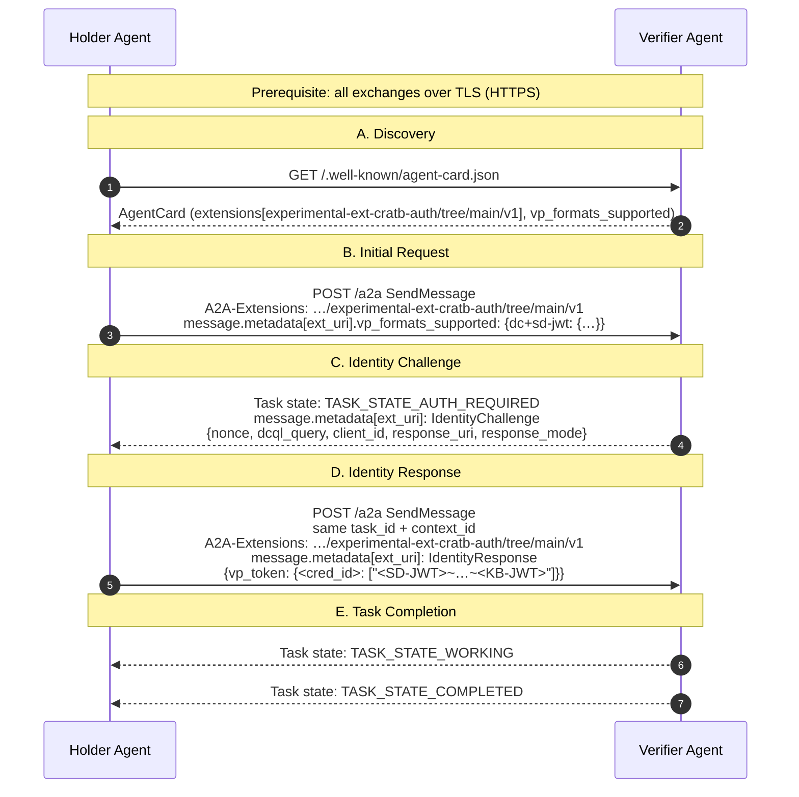
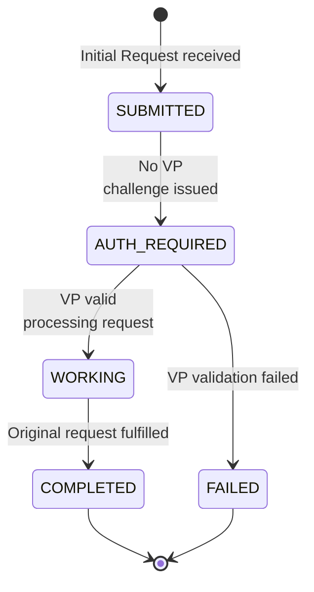

# CRATB-Auth: Claim Rich Agent Task Bound Authentication — A2A Protocol Extension

> **Status:** Draft<br/>
> **Version:** v0.1<br/>
> **Authors:** Yonatan Alejandro Arguello (Thales), Debora Comparin (Thales), Ward Duchamps (Thales), Paul Sydney Orozco (Thales), Mike Smith (Google), Antoine Larmanjat (Google)<br/>
> **Created:** <br/>
> **Last Updated:** 2026-10-26<br/>

---

## 1. Abstract

This document specifies an extension to the A2A Protocol that enables server agents to verify the identity of client agents before fulfilling requests. The extension defines an in-band handshake using OpenID for Verifiable Presentations (OID4VP) with the `dc+sd-jwt` credential format. The challenge structure conforms to the OID4VP Authorization Request; the response conforms to the OID4VP Authorization Response. Both are carried in-band via A2A `message.metadata` fields. The handshake runs single-hop, between a server agent and its direct client, and an optional profile extends it to multi-hop delegation, in which intermediate agents relay the challenge and response unchanged while the presentation stays bound to the requesting server agent.

---

## 2. Extension URI

```
https://github.com/a2aproject/experimental-ext-cratb-auth/tree/main/v1
```

MUST be used verbatim in all declaration and activation contexts.

---

## 3. Extension Type & Scope

| Property | Value |
|---|---|
| **Type** | Profile Extension |
| **Credential type** | `AIAgentIdentityCredential` (`dc+sd-jwt`) - see [5](#5-ai-agent-identity) |
| **Required** | `true` - clients that do not activate this extension MUST be rejected |
| **Streaming impact** | Yes - adds `AUTH_REQUIRED` event before `WORKING` |

---

## 4. Extension Declaration (Agent Card)

The extension-specific addition is the `params` field, which carries the VP format configuration shown below:

```json
{
  "capabilities": {
    "extensions": [
      {
        "uri": "https://github.com/a2aproject/experimental-ext-cratb-auth/tree/main/v1",
        "description": "Requires Verifiable Presentation before processing requests.",
        "required": true,
        "params": {
          "vp_formats_supported": {
            "dc+sd-jwt": {
              "sd-jwt_alg_values": ["ES256"],
              "kb-jwt_alg_values": ["ES256"]
            }
          }
        }
      }
    ]
  }
}
```

### 4.1. Agent Card `params` Schema

| Field | Type | Required | Description |
|---|---|---|---|
| `vp_formats_supported` | object | Yes | Credential formats and signing algorithms accepted by the Verifier Agent. MUST include `dc+sd-jwt`. |
| `vp_formats_supported["dc+sd-jwt"].sd-jwt_alg_values` | string[] | Yes | JWS algorithms supported for the SD-JWT portion. MUST include `"ES256"`. |
| `vp_formats_supported["dc+sd-jwt"].kb-jwt_alg_values` | string[] | Yes | JWS algorithms supported for the Key Binding JWT. MUST include `"ES256"`. |
| `channel_binding` | string[] | No | Channel binding types the Verifier Agent requires in every KB-JWT it accepts. The only value defined by this version is `"tls-exporter"` ([RFC9266](#rfc9266)). If present, the Verifier Agent requires channel-bound presentations under [12.8](#128-channel-binding---presentation-leakage). If absent, presentations are not channel-bound. |

---

## 5. AI Agent Identity

### 5.1. Definition

An **AI Agent Identity** is a verifiable, issuer-attested set of properties that uniquely describe an autonomous software agent and the **Subject** responsible for it.

An AI Agent Identity is verifiable (cryptographically signed by a trusted issuer; any mechanism producing an SD-JWT VC conformant to [SD-JWT-VC](#sd-jwt-vc) and this profile—including the required `vct`, `typ: dc+sd-jwt`, and `cnf.jwk` holder binding—is conformant; OID4VCI [OID4VCI](#oid4vci) and evolution of the [SPIFFE](#spiffe)/SPIRE-based workload identity frameworks are two examples), holder-bound (tied to a key pair controlled by the agent; the agent proves possession at presentation time via a Key Binding JWT), selectively disclosable (individual claims revealed or withheld per the verifier's DCQL query), and subject-bound (always associated with a responsible Subject - a **Legal Person**, such as an organisation, or a **Natural Person**, such as an individual).

### 5.2. Identity Properties

The following properties constitute the canonical AI Agent Identity. Required properties MUST be present in any conformant `AIAgentIdentityCredential`. Optional properties MAY be included by the issuer. For the SD-JWT encoding of these claims, see [9.2](#92-claims-schema).

> The properties below reflect the minimum claim set required for this extension. As the identity model matures, implementors SHOULD monitor alignment with the ITU-T **X.aiidm** (*Canonical Agentic AI Identity Data Model*) [X.AIIDM](#x-aiidm), which is developing a technology-neutral abstract data model covering agentic identity attributes, claim vocabularies, and governance bindings. Future versions of this extension MAY adopt X.aiidm as the normative semantic foundation for these properties.

| Property | Type | Required | Disclosure Policy | Description |
|---|---|---|---|---|
| `id` | `string` | Yes | always | Stable identifier for this agent. SHOULD be an HTTPS URL or a DID; format is otherwise implementor-defined. Always present as plaintext; MUST NOT be wrapped in a selective disclosure. |
| `name` | `string` | Yes | on demand | Human-readable name of the agent. MUST be unique within the owner's namespace. |
| `description` | `string` | Yes | on demand | Short description of the agent's purpose or function. |
| `owner` | `object` | Yes | on demand | The Subject responsible for operating this agent - a Legal Person (such as an organisation) or a Natural Person (such as an individual). Disclosed as a single atomic unit; sub-fields not independently selectable. |
| `owner.id` | `string` | Yes | on demand (as part of `owner`) | Unique identifier of the Subject. MAY be an internal identifier or a DID. |
| `owner.name` | `string` | Yes | on demand (as part of `owner`) | Display name of the Subject. |
| `owner.type` | `string` | No | on demand (as part of `owner`) | Type of the Subject. Allowed values: `"legal_person"`, `"natural_person"`. |
| `status` | `object` | No | always (if present) | Token status reference per [TSL](#tsl). Always disclosed as plaintext if present. See [9.3](#93-issuer-signed-jwt-structure). |
| `key_protection_level` | `string` | No | on demand | Issuer-attested level of protection for the holder private key. Allowed values: `"software"` (key held in OS-level storage), `"hardware_tee"` (key held in a Trusted Execution Environment or Secure Enclave), `"hardware_hsm"` (key held in a FIPS 140-3 Level 3+ HSM or Secure Element). |

Implementors SHOULD apply data minimisation when disclosing selectively disclosable claims. Verifier Agents SHOULD request only the claims strictly necessary to fulfil their policy, and Holder Agents SHOULD NOT disclose claims beyond what the DCQL query requires. Claims carrying sensitive organisational or personal information - for example, `owner`, which identifies the responsible Subject - SHOULD only be disclosed where proportionate to the trust relationship established between the parties.

### 5.3. Identity Lifecycle

An AI Agent Identity passes through four normative phases:

1. **Issuance.** Trusted issuer attests agent properties, binding them cryptographically to holder public key via OID4VCI Pre-Authorized Code Flow (RECOMMENDED) or equivalent SD-JWT-VC issuance mechanism. Result: `AIAgentIdentityCredential`.

2. **Provisioning.** Holder Agent stores issued credential and holder private key in secure, durable storage, available at handshake time. See [9.7](#97-credential-provisioning).

3. **Presentation.** During the A2A handshake (Identity Response), the Holder Agent selects the claims requested by the Verifier Agent's DCQL query, constructs an SD-JWT Presentation, and appends a Key Binding JWT cryptographically bound to the Verifier Agent's nonce and `client_id`. In multi-agent environments the Holder Agent SHOULD include `conversation_id` (the A2A `context_id`) and `domains` as additional top-level KB-JWT claims to further scope the presentation to a specific conversation and an explicit set of authorized Verifier Agents. In a tunneled presentation the Holder Agent MUST NOT include `conversation_id` except as [12.6.1](#1261-delegated-challenge-tunneling-profile-multi-hop) Rule 2 allows. See [9.5](#95-sd-jwt-presentation-structure), [12.6](#126-presentation-scoping---conversation-binding-and-domain-restriction).

4. **Verification.** Verifier Agent validates SD-JWT issuer signature, KB-JWT signature, nonce, aud, and optional conversation_id/domains claims. See [7.3.4](#734-identity-response). On success, the Verifier Agent MUST open an **Authenticated Task Session** for the `task_id`. See [5.5](#55-authenticated-task-session).

### 5.4. Trust Model

| Trust Anchor | Role |
|---|---|
| **Issuer** | Root of trust. Signs the `AIAgentIdentityCredential`. The Verifier Agent MUST establish trust in the issuer's public key using a permitted key-discovery mechanism under [SD-JWT-VC](#sd-jwt-vc): via JWT VC Issuer Metadata (`/.well-known/jwt-vc-issuer` constructed per SD-JWT VC path insertion rules) or via certificate chain validation from an `x5c` header parameter under configured trust policy. |
| **Holder key (`cnf.jwk`)** | Embedded in the credential by the issuer at issuance time. Proves that the presenting agent controls the corresponding private key. |
| **Nonce** | Generated fresh per IdentityChallenge by the Verifier Agent. Prevents replay of previously issued Verifiable Presentations. |
| **`aud` claim (KB-JWT)** | Set to the Verifier Agent's own `client_id`. Prevents cross-server reuse of a captured Verifiable Presentation. |
| **`conversation_id` claim (KB-JWT)** | OPTIONAL. Set to the A2A `context_id`. Prevents reuse of this VP across different A2A conversations, even against the same Verifier Agent. |
| **`domains` claim (KB-JWT)** | OPTIONAL. Array of complete `client_id` strings, including any Client Identifier Prefix, the Holder Agent authorizes to accept this VP. Verifier Agent MUST reject if its own complete `client_id` is absent from the list. |
| **`channel_binding` claim (KB-JWT)** | REQUIRED when the Verifier Agent declares `channel_binding` in its Agent Card. The `tls-exporter` value of the TLS connection that carries the Identity Response. Prevents a captured, not yet consumed VP from being submitted over another connection. See [12.8](#128-channel-binding---presentation-leakage). |
| **Status list service** (optional) | Operated by or on behalf of the issuer. Provides a [TSL](#tsl)-compliant bit array indicating revocation/suspension status for issued credentials. Consulted by the Verifier Agent when `status` is present in the credential. |

### 5.5. Authenticated Task Session

An A2A task MAY involve multiple messages on the same `task_id` (for example, an initial handshake followed by later task turns or step-up requests). This section defines how identity verification persists across those messages.

1. **Unguessable Task IDs:** The Verifier Agent MUST generate `task_id` using a cryptographically secure random number generator (CSPRNG) with at least 128 bits of entropy (e.g. 16 cryptographically random bytes). Knowledge or possession of a `task_id` alone MUST NOT grant access to a task session. Task ids are server-generated ([A2A-SPEC](#a2a-spec) 3.4.2): a Holder Agent MUST NOT choose a `task_id` for a new task, and a `task_id` in a message MUST reference a task the Verifier Agent allocated and still holds. A message that names any other `task_id` MUST be rejected with the standard A2A `TaskNotFoundError` (JSON-RPC `-32001`, HTTP+JSON `404 Not Found`, gRPC `NOT_FOUND`, with a `google.rpc.ErrorInfo` of reason `TASK_NOT_FOUND`), without creating or altering any task state.
2. **Transport Connection Binding:** Upon successful presentation verification, the Verifier Agent MUST bind the Authenticated Task Session to the client's authenticated transport channel (TLS connection / session context). Subsequent messages on that `task_id` MUST only be accepted from the same bound channel. Server-authenticated TLS or a matching `context_id` alone does not establish caller identity across distinct connections. When the Verifier Agent requires channel binding ([12.8](#128-channel-binding---presentation-leakage)), the bound channel is the TLS connection whose `tls-exporter` value the verified KB-JWT carries, and every step-up presentation on the session MUST carry the `tls-exporter` value of that same connection.
3. **Loss of Continuity & Reconnect:** Any message on an existing `task_id` arriving from an unbound or new connection MUST NOT be accepted under the cached identity; the Verifier Agent MUST either reject the message or require re-authentication proving control of the originally bound Holder key (`cnf.jwk`). An unrelated credential MUST NOT replace task ownership.
4. **Step-Up Challenge Precedence:** A Verifier Agent MAY issue a fresh `IdentityChallenge` (a "step-up challenge") for sensitive operations. Outstanding step-up challenges MUST be processed by the verification path before routine message dispatch, and the protected operation MUST NOT execute until successful verification.
5. **Session Lifecycle & Cleanup:** The Verifier Agent MUST discard the Authenticated Task Session record when the task reaches any terminal state (`COMPLETED`, `FAILED`, `CANCELED`, or `REJECTED`).

Initial-request dispatch eligibility is separate from challenge and session state. Successful step-up or reconnect reauthentication MUST NOT redispatch the Initial Request. Retained-original release, its once-only guard, and bounded content cleanup follow [7.3.2](#732-initial-request) and [7.3.5](#735-task-completion); opening or renewing an Authenticated Task Session MUST NOT reset that guard.

---

## 6. Extension Activation

Header activation and required-extension enforcement follow [A2A-EXT](#a2a-ext) and [A2A-SPEC](#a2a-spec) 3.2.6, 3.3.4. Extension-specific preconditions and failures:

> **Note on downstream authorization.** This core profile standardizes in-band A2A agent client identity verification and does not require a runtime round trip to an OAuth Authorization Server. Downstream OAuth authorization and token exchange are outside its scope and require a separately specified reliance and delegation profile. Implementors MUST NOT treat a presentation bound to an A2A Verifier as a fresh Holder presentation addressed to another recipient merely because it has been forwarded.

### 6.1. Activation Precondition

The Holder Agent MUST have a valid `AIAgentIdentityCredential` and its corresponding holder private key provisioned before activating this extension. See [9.7](#97-credential-provisioning).

### 6.2. Activation Failure

If this extension is declared `required: true` and the client has not declared support for its URI through the applicable A2A extension service parameter, the Verifier Agent MUST return the standard A2A `ExtensionSupportRequiredError`. This applies when the service parameter is absent or does not contain the required extension URI after exact token parsing.

The standard mapping is JSON-RPC error code `-32008`, HTTP+JSON status `400 Bad Request`, or gRPC `FAILED_PRECONDITION`, according to the selected binding. The Verifier Agent MUST NOT substitute an extension-defined failed Task for this protocol error.

A2A makes the `google.rpc.ErrorInfo` detail mandatory for A2A-specific errors in every standard binding ([A2A-SPEC](#a2a-spec) 9.5, 10.6, 11.6), so the Verifier Agent MUST include one with reason `EXTENSION_SUPPORT_REQUIRED` (the error type in UPPER_SNAKE_CASE without the `Error` suffix) and domain `a2a-protocol.org`. It is carried in the binding's detail array: `error.data` for JSON-RPC, `error.details` for HTTP+JSON, and `status.details` for gRPC. This extension defines `extensionUri` in ErrorInfo metadata as its convention for identifying the missing extension URI; this metadata key is not mandated by base A2A.

Illustrative JSON-RPC error response:

```json
{
  "jsonrpc": "2.0",
  "id": "request-1",
  "error": {
    "code": -32008,
    "message": "Required extension support was not declared",
    "data": [
      {
        "@type": "type.googleapis.com/google.rpc.ErrorInfo",
        "reason": "EXTENSION_SUPPORT_REQUIRED",
        "domain": "a2a-protocol.org",
        "metadata": {
          "extensionUri": "https://github.com/a2aproject/experimental-ext-cratb-auth/tree/main/v1"
        }
      }
    ]
  }
}
```

Illustrative HTTP+JSON error response (status `400 Bad Request`, `Content-Type: application/a2a+json`). The A2A HTTP+JSON binding names the detail array `details` and carries the gRPC status name in `status`:

```json
{
  "error": {
    "code": 400,
    "status": "FAILED_PRECONDITION",
    "message": "Required extension support was not declared",
    "details": [
      {
        "@type": "type.googleapis.com/google.rpc.ErrorInfo",
        "reason": "EXTENSION_SUPPORT_REQUIRED",
        "domain": "a2a-protocol.org",
        "metadata": {
          "extensionUri": "https://github.com/a2aproject/experimental-ext-cratb-auth/tree/main/v1"
        }
      }
    ]
  }
}
```

For gRPC, the same `google.rpc.ErrorInfo` is placed in `status.details` of a `google.rpc.Status` with code `FAILED_PRECONDITION`.

Errors occurring in an admitted task's presentation-verification flow are distinct from required-extension activation errors. If the Holder Agent provides a `vp_token` in an unsupported format or signed with an unsupported algorithm, the Verifier Agent MUST respond with `TASK_STATE_FAILED` and task error code `VP_FORMAT_UNSUPPORTED` under [11.2](#112-error-response-format).

### 6.3. Protocol Version

This extension is defined for A2A v1.0.0 only and does not support earlier A2A protocol versions. A2A identifies the protocol version in use by its `Major.Minor` elements and carries it in the `A2A-Version` service parameter ([A2A-SPEC](#a2a-spec) 3.6); patch versions do not affect compatibility.

- The Holder Agent MUST send `A2A-Version: 1.0` with every request to the Verifier Agent.
- The Verifier Agent MUST process requests using the semantics of the version the request states. A2A defines an empty or absent `A2A-Version` as `0.3` ([A2A-SPEC](#a2a-spec) 3.6.2), so a request without it, or one that states any version other than `1.0`, MUST be rejected with the standard A2A `VersionNotSupportedError` and MUST NOT be served under v0.3 semantics.
- The standard mapping is JSON-RPC error code `-32009`, HTTP+JSON status `400 Bad Request`, or gRPC `FAILED_PRECONDITION`. As in [6.2](#62-activation-failure), it is a protocol error, not a failed Task, and it carries a `google.rpc.ErrorInfo` with reason `VERSION_NOT_SUPPORTED` and domain `a2a-protocol.org`.

The check applies before task admission: a request rejected under this section creates no task, nonce or retained state.

---

## 7. Protocol Flow

### 7.1. Roles

| Role | Responsibilities |
|---|---|
| **Verifier Agent** (server) | Declares the extension; detects activation; generates identity challenge; validates VP |
| **Holder Agent** (client) | Discovers the extension; activates via `A2A-Extensions` header; receives challenge; constructs and submits SD-JWT VP in Identity Response on same `task_id` and `context_id` |

### 7.2. Sequence Diagram

All exchanges in this protocol flow MUST be carried over TLS (HTTPS). The Holder Agent MUST validate the contacted HTTPS server's certificate and authority. The Holder MUST bind the challenge's `a2a_agent_card:` Client Identifier to the canonical Agent Card or contacted interface URL using the authenticated TLS context and same-origin checks in [8.1.1](#811-agent-card-client-identifier-binding) before presentation construction or KB-JWT signing. This origin-level trust does not independently establish isolated ownership of agents sharing that origin. The VP handshake defined in this extension provides complementary application-layer identity attestation for the Holder Agent. Implementations operating in high-assurance environments MAY additionally enforce mutual TLS (mTLS) at the transport layer.



### 7.3. Step Descriptions

#### 7.3.1. Discovery

Holder Agent locates the extension entry (URI from [2](#2-extension-uri)) and reads `params.vp_formats_supported` to determine accepted credential formats and algorithms.

#### 7.3.2. Initial Request

The Holder Agent sends a `SendMessage` request carrying:

- The `A2A-Extensions` header ([6](#6-extension-activation)) and `A2A-Version: 1.0` ([6.3](#63-protocol-version))
- No `taskId`: task ids are server-generated ([5.5](#55-authenticated-task-session), [A2A-SPEC](#a2a-spec) 3.4.2), and the Verifier Agent allocates the `task_id` (and the `context_id`, when the request carries none) when it admits the request
- Optionally, `message.metadata[ext_uri].vp_formats_supported`: a hint from the Holder Agent. See the paragraph after the example.

```json
{
  "jsonrpc": "2.0",
  "id": "initial-request-1",
  "method": "SendMessage",
  "params": {
    "message": {
      "messageId": "<holder_message_uuid>",
      "role": "ROLE_USER",
      "parts": [{ "text": "<request payload>" }],
      "metadata": {
        "https://github.com/a2aproject/experimental-ext-cratb-auth/tree/main/v1": {
          "vp_formats_supported": {
            "dc+sd-jwt": {
              "sd-jwt_alg_values": ["ES256"],
              "kb-jwt_alg_values": ["ES256"]
            }
          }
        }
      }
    }
  }
}
```

The Holder Agent MAY include `vp_formats_supported` in the Initial Request. The field has the same structure as the `vp_formats_supported` field in [4.1](#41-agent-card-params-schema). It is a hint from the Holder Agent. It is not a policy. The Verifier Agent MAY use this field to select, from its own policy, the formats and algorithms that it expects for this task. The Verifier Agent MUST NOT accept a format or algorithm that its own `vp_formats_supported` policy from the Agent Card does not list. The Verifier Agent MUST NOT reject the Initial Request because of this field. The Verifier Agent MUST check each presentation as defined in [7.3.4](#734-identity-response) step 2. If the Verifier Agent uses the hint, the effective policy for that step is the intersection of the hint and the Agent Card policy. The Holder Agent MUST NOT assume that the Verifier Agent accepts a format or algorithm because the Holder Agent listed it.

Upon receiving the Initial Request requiring identity verification, the Verifier Agent MUST:

1. Perform deterministic protocol, schema, size, and resource-limit checks. Parsing, extension negotiation, rate limiting, and bounded inert storage are permitted before authentication; business execution is not.
2. Until initial identity verification succeeds, MUST NOT process the Initial Request's business content or expose its `parts` to any reasoning component, business handler, or tool executor, including indirectly through model-visible history or reasoning-backed logging.
3. Before issuing the initial challenge, retain an immutable server-controlled snapshot of the original business `parts`, relevant non-identity `metadata`, and originating `messageId`, associated with the server's `task_id` and `context_id`. Later Identity Response content MUST NOT replace, append to, or mutate this snapshot.
4. Enforce configured limits on retained content size, pending-request count, and retention lifetime. If the request cannot be safely retained within those limits, reject admission without business dispatch rather than issue a challenge whose original payload cannot be preserved.
5. Generate a cryptographically random nonce (see [12.1](#121-nonce---replay-protection)) and associate it with that same pending request and its task/context, recording the challenge purpose as initial authentication.
6. Emit the Task in state `TASK_STATE_AUTH_REQUIRED`, carrying the `IdentityChallenge` ([8.1](#81-identitychallenge)) in `task.status.message.metadata`. The status message is a complete A2A Message: it carries a `messageId`, `role` `ROLE_AGENT`, and the `taskId` and `contextId` of the task. In response to a blocking `SendMessage` this Task is returned in the `SendMessageResponse` ([7.3.3](#733-identity-challenge)). On a streaming operation ([A2A-SPEC](#a2a-spec) 3.2.3) the same status is delivered as a `StreamResponse` whose `statusUpdate` is a `TaskStatusUpdateEvent` (illustrated below).

Illustrative streaming form of step 6 (`StreamResponse` with a `statusUpdate`; `taskId`, `contextId` and `status` are required by A2A):

```json
{
  "statusUpdate": {
    "taskId": "<task_id>",
    "contextId": "<context_id>",
    "status": {
      "state": "TASK_STATE_AUTH_REQUIRED",
      "message": {
        "messageId": "<server_message_uuid>",
        "taskId": "<task_id>",
        "contextId": "<context_id>",
        "role": "ROLE_AGENT",
        "parts": [{ "text": "Identity verification required." }],
        "metadata": {
          "https://github.com/a2aproject/experimental-ext-cratb-auth/tree/main/v1": {
            "status": "identity_required",
            "nonce": "<cryptographically-random-value>",
            "dcql_query": { "...": "see 7.3.3" },
            "client_id": "<a2a_agent_card:...>",
            "response_uri": "<https response_uri>",
            "response_mode": "a2a_metadata"
          }
        }
      }
    }
  }
}
```

This profile selects **Verifier-side buffering**: the Holder is not required to repeat business content in its Identity Response. Release and cleanup of the retained request follow [7.3.5](#735-task-completion).

Task creation and the `TASK_STATE_SUBMITTED` > `TASK_STATE_AUTH_REQUIRED` transition follow [A2A-SPEC](#a2a-spec) 7.6.1.

#### 7.3.3. Identity Challenge

Verifier Agent responds with a Task in state `TASK_STATE_AUTH_REQUIRED` carrying the `IdentityChallenge` in `task.status.message.metadata[ext_uri]`. In JSON-RPC, the Task is returned in the `result.task` wrapper:

```json
{
  "jsonrpc": "2.0",
  "id": "initial-request-1",
  "result": {
    "task": {
      "id": "<task_id>",
      "contextId": "<context_id>",
      "status": {
        "state": "TASK_STATE_AUTH_REQUIRED",
        "message": {
          "messageId": "<server_message_uuid>",
          "taskId": "<task_id>",
          "contextId": "<context_id>",
          "role": "ROLE_AGENT",
          "parts": [{ "text": "Identity verification required." }],
          "metadata": {
            "https://github.com/a2aproject/experimental-ext-cratb-auth/tree/main/v1": {
              "status": "identity_required",
              "nonce": "<cryptographically-random-value>",
              "dcql_query": {
                "credentials": [
                  {
                    "id": "agent_identity",
                    "format": "dc+sd-jwt",
                    "meta": {
                      "vct_values": [
                        "https://github.com/a2aproject/experimental-ext-cratb-auth/tree/main/v1"
                      ]
                    },
                    "claims": [
                      { "path": ["name"] },
                      { "path": ["description"] },
                      { "path": ["owner"] }
                    ]
                  }
                ]
              },
              "client_id": "<verifier-agent-url>",
              "response_uri": "<verifier-agent-a2a-endpoint>",
              "response_mode": "a2a_metadata"
            }
          }
        }
      }
    }
  }
}
```

#### 7.3.4. Identity Response

Before the Holder Agent builds a presentation or signs a KB-JWT for a direct `IdentityChallenge`, the Holder Agent MUST verify the `client_id` of the Verifier. The Holder Agent compares the complete `a2a_agent_card:` Client Identifier with the canonical Agent Card URL or interface URL that the Holder Agent contacted over TLS. The Holder Agent also applies the same-origin checks in [8.1.1](#811-agent-card-client-identifier-binding). If the binding is missing or does not match, the Holder Agent MUST NOT generate a presentation.

When the check succeeds, the Holder Agent builds a conformant SD-JWT Presentation ([9.5](#95-sd-jwt-presentation-structure)) from its `AIAgentIdentityCredential`. The KB-JWT is bound to the received `nonce`. Its `aud` is the validated complete `client_id`, unchanged, including its prefix. The Holder Agent then sends:

```json
{
  "jsonrpc": "2.0",
  "id": "identity-response-1",
  "method": "SendMessage",
  "params": {
    "message": {
      "messageId": "<holder_message_uuid>",
      "taskId": "<task_id from Initial Request>",
      "contextId": "<context_id from Initial Request>",
      "role": "ROLE_USER",
      "parts": [{ "text": "Identity response." }],
      "metadata": {
        "https://github.com/a2aproject/experimental-ext-cratb-auth/tree/main/v1": {
          "vp_token": {
            "agent_identity": [
              "<Issuer-signed JWT>~<Disclosure 1>~<Disclosure 2>~<Disclosure 3>~<KB-JWT>"
            ]
          }
        }
      }
    }
  }
}
```

The Verifier Agent MUST NOT dispatch the `parts` of an Identity Response as business content, even if they repeat or change the original request. Neither these `parts` nor the response metadata can replace, add to, or change the retained original business snapshot. Only the authentication flow handles the identity metadata. Before the Verifier Agent releases or cleans up retained content, it MUST correlate the response with its server-controlled pending challenge, its task and context association, and its recorded purpose. A malformed, unbound, or mismatched response MUST NOT, by itself, authorize deletion of the retained content of another pending request.

**Response Classification and Missing Presentation Handling.** Apply these rules when a task is in `TASK_STATE_AUTH_REQUIRED` with an active challenge:

- A message for that `task_id` that carries `message.metadata[ext_uri]` is an Identity Response. It tries to satisfy the pending `IdentityChallenge`. If the metadata has no `vp_token` field, or if `vp_token` is null, empty, or has no presentations, the Verifier Agent MUST reject the response and emit `TASK_STATE_FAILED` with error `VP_MISSING`.
- A follow-up message for that `task_id` that has no `message.metadata[ext_uri]` is not an Identity Response. This does not apply to an explicit A2A task cancellation or a supported pre-auth negotiation or refusal ([A2A-SPEC](#a2a-spec) 7.6.1). The Verifier Agent MUST NOT treat the message as a new Initial Request. The Verifier Agent MUST NOT start an unconstrained re-challenge loop. The Verifier Agent MUST NOT generate a new nonce that overwrites the active challenge. The Verifier Agent MUST reject the message and emit `TASK_STATE_FAILED` with error `VP_MISSING`.

A message that carries `tunneled_response` on a task where the receiving agent has relayed a tunneled challenge ([12.6.1](#1261-delegated-challenge-tunneling-profile-multi-hop)) is outside this classification. It is not an Identity Response to a challenge of the receiving agent.

When the Verifier Agent receives the Identity Response, it MUST do these steps in order:

1. Parse the SD-JWT Presentation. Split the `~`-delimited presentation string into the Issuer-signed JWT (first segment), the Disclosures (middle segments), and the KB-JWT (last segment).
   - If the string cannot be parsed as a delimited presentation, emit `TASK_STATE_FAILED` with error `VP_MALFORMED`. Also emit `VP_MALFORMED` if a segment has a malformed compact JWS, invalid base64url encoding, or unparseable JSON.
   - If the string is a recognized SD-JWT presentation but the KB-JWT is absent or empty, emit `TASK_STATE_FAILED` with error `VP_KEY_BINDING_MISSING`. Examples: the string ends with a trailing `~` and no KB-JWT segment, or it omits the key binding segment that this profile requires.
2. Verify the format and the declared algorithms against `vp_formats_supported`. The credential format MUST be supported by the effective policy of the Verifier Agent (`vp_formats_supported`, which requires `dc+sd-jwt`). Read the unverified JOSE headers of the Issuer-signed JWT and of the Key Binding JWT:
   - The `alg` of the Issuer-signed JWT header MUST be present and MUST NOT be `none`. It MUST match an entry in `vp_formats_supported["dc+sd-jwt"].sd-jwt_alg_values`, which MUST include `"ES256"`. The header `typ` MUST be `dc+sd-jwt`. Any other value is a format failure under this step.
   - The `alg` of the KB-JWT header MUST be present and MUST NOT be `none`. It MUST match an entry in `vp_formats_supported["dc+sd-jwt"].kb-jwt_alg_values`, which MUST include `"ES256"`. The header `typ` MUST be `kb+jwt`. Any other value is a format failure under this step.
   - Emit `TASK_STATE_FAILED` with error `VP_FORMAT_UNSUPPORTED` if the credential format is unsupported, if a declared algorithm is absent from its list in `vp_formats_supported` or is `none`, or if a `typ` is not the required value.
   - These header values (`alg`, `typ`, `iss`, `kid`, `x5c`) are unauthenticated. The Verifier Agent MUST NOT trust them before the signature is verified.
3. Verify the signature of the Issuer-signed JWT. Resolve the verification key of the issuer with a mechanism that [SD-JWT-VC](#sd-jwt-vc) permits for that issuer:
   - JWT VC Issuer Metadata. Build `/.well-known/jwt-vc-issuer` with the SD-JWT VC path insertion rules. Require an exact match of `issuer` with `iss`. Select the key from `jwks` or `jwks_uri`.
   - The certificate chain in the `x5c` header parameter, validated under the configured trust policy.

   The signature verification MUST succeed with the resolved trusted key. If it fails, emit `TASK_STATE_FAILED` with error `VP_SIGNATURE_INVALID`.
4. Validate the temporal claims of the Issuer-signed JWT.
   - `exp` MUST be present, MUST be an integer, and MUST NOT have elapsed. If it has elapsed, emit `TASK_STATE_FAILED` with error `VP_CREDENTIAL_EXPIRED`.
   - `iat` MUST be present, MUST be an integer, and MUST NOT be in the future beyond the allowed clock skew.
   - If `exp` or `iat` is missing, emit `TASK_STATE_FAILED` with error `VP_FORMAT_UNSUPPORTED`.
5. Validate credential profile and required plaintext claims:
   - Verify that `_sd_alg` is present in the Issuer-signed JWT payload and its value is `"sha-256"`. If absent, unsupported, or if nested inside a disclosure, the Verifier Agent MUST reject the presentation with error `VP_SIGNATURE_INVALID`.
   - Verify that `vct` is present as a string in the top-level payload, is plaintext (MUST NOT be selectively disclosed or present in `_sd`), and matches one of the requested `meta.vct_values` in the corresponding Credential Query exactly and case-sensitively under this core exact-type profile (`https://github.com/a2aproject/experimental-ext-cratb-auth/tree/main/v1`). If `vct` is missing, selectively disclosed, or does not match `meta.vct_values`, emit `TASK_STATE_FAILED` with error `VP_DCQL_UNSATISFIED`.
   - Verify that `id` is present as a non-empty string in the top-level payload, is plaintext (MUST NOT be selectively disclosed or present in `_sd`). If `id` is missing, empty, or selectively disclosed, emit `TASK_STATE_FAILED` with error `VP_SIGNATURE_INVALID`. If `sub` is present, verify that `sub == id`.
   - Extract the holder public key from `cnf.jwk` in the verified Issuer-signed JWT payload (which MUST be an EC P-256 JWK, never selectively disclosed). If `cnf.jwk` is missing, emit `TASK_STATE_FAILED` with error `VP_FORMAT_UNSUPPORTED`. If it is present but is not a valid EC P-256 JWK, emit `TASK_STATE_FAILED` with error `VP_SIGNATURE_INVALID`.
6. Validate the disclosures and construct the Processed SD-JWT Payload as [RFC 9901](#rfc9901) Section 7.1 specifies. For each disclosure segment in the presentation string:
   - Compute the disclosure digest: `base64url(SHA-256(US-ASCII(disclosure_string)))`.
   - Check for duplicates. Each disclosure digest MUST be unique across all supplied disclosures. A duplicate digest or a collision MUST cause rejection with error `VP_SIGNATURE_INVALID`.
   - Check the digest reference. Each computed disclosure digest MUST match an entry in the `_sd` array of the Issuer-signed JWT payload (or in a nested structure). A supplied disclosure whose digest the credential structure does not reference MUST cause rejection with error `VP_SIGNATURE_INVALID`.
   - Parse the disclosure JSON array `[salt, claim_name, claim_value]`. `salt` MUST be a string with at least 128 bits of entropy. `claim_name` MUST be a string and MUST NOT be a reserved name (`_sd`, `...`, `_sd_alg`). Check for claim name collisions at the same JSON object level.

   Then construct the Processed SD-JWT Payload. Inject all validly disclosed claims. Remove the disclosure-control material (`_sd`, `...`, `_sd_alg`). Ignore undisclosed claims and decoy digests.

   If a disclosure fails parsing, digest verification, the duplicate check, the unreferenced-disclosure check, or the collision check, emit `TASK_STATE_FAILED` with error `VP_SIGNATURE_INVALID`. If a disclosure structure cannot be parsed, emit `VP_MALFORMED` instead.
7. Verify the signature of the Key Binding JWT and the `sd_hash` binding as [RFC 9901](#rfc9901) Section 7.3 specifies:
   - The KB-JWT header MUST contain `typ: kb+jwt`, and its `alg` MUST match the holder key from `cnf.jwk`. If the KB-JWT payload lacks a required claim (`nonce`, `aud`, `sd_hash`, `iat`), or a required claim has the wrong type, emit `TASK_STATE_FAILED` with error `VP_FORMAT_UNSUPPORTED`.
   - Verify the KB-JWT signature with the holder public key from `cnf.jwk`. If the verification fails, emit `TASK_STATE_FAILED` with error `VP_SIGNATURE_INVALID`.
   - Verify `sd_hash` in the KB-JWT payload. Compute the expected digest over the presented SD-JWT body:
     ```text
     expected_sd_hash = base64url(SHA-256(US-ASCII(<Issuer JWT>~<Disclosure 1>~...~<Disclosure N>~)))
     ```
     Include all trailing tildes before the KB-JWT. For zero disclosures, the body is `<Issuer JWT>~`. `kb_payload.sd_hash` MUST exactly equal `expected_sd_hash`. If `sd_hash` is missing or does not match, emit `TASK_STATE_FAILED` with error `VP_SIGNATURE_INVALID`.
8. Validate the freshness and the transaction and context binding of the KB-JWT:
   - `iat` MUST be present in the KB-JWT payload and MUST be an integer Unix timestamp. It MUST NOT be in the future beyond the allowed clock skew (RECOMMENDED: 60 seconds). It MUST be inside the freshness window of the Verifier Agent (RECOMMENDED: maximum age 300 seconds, that is, 5 minutes). If `iat` is missing, is not an integer, is in the future beyond the skew, or is older than the freshness window, emit `TASK_STATE_FAILED` with error `VP_SIGNATURE_INVALID`.
   - The `nonce` claim in the KB-JWT MUST match the stored nonce for the `task_id`. If it does not match, emit `TASK_STATE_FAILED` with error `VP_NONCE_MISMATCH`.
   - The `aud` claim in the KB-JWT MUST equal the complete Client Identifier (`client_id`) of the Verifier Agent, including the `a2a_agent_card:` prefix. If it does not, emit `TASK_STATE_FAILED` with error `VP_AUDIENCE_MISMATCH`.
   - If the KB-JWT has a `conversation_id` claim, it MUST equal the `context_id` of the current task. If it does not, emit `TASK_STATE_FAILED` with error `VP_CONVERSATION_MISMATCH`.
   - If the KB-JWT has a `domains` claim, the complete `client_id` of the Verifier Agent MUST be in the array. If it is not, emit `TASK_STATE_FAILED` with error `VP_DOMAIN_NOT_ALLOWED`.
   - If the Verifier Agent declares `channel_binding` in its Agent Card, the KB-JWT MUST have a `channel_binding` claim, and its value MUST equal the base64url-encoded `tls-exporter` value of the TLS connection on which this Identity Response arrived, computed as [12.8](#128-channel-binding---presentation-leakage) specifies. If the claim is missing, or the values differ, or the Verifier Agent cannot obtain the `tls-exporter` value of that connection, emit `TASK_STATE_FAILED` with error `VP_CHANNEL_BINDING_MISMATCH`. If the Verifier Agent does not declare `channel_binding` and the claim is present, the Verifier Agent MAY ignore it.
9. If the Issuer-signed JWT has a `status` claim, check the referenced Token Status List entry. Retrieve and decompress the list. Verify the status entry at `idx` with width-aware bit extraction (LSB-first, as [TSL](#tsl) specifies). If the entry marks the credential as revoked or suspended, emit `TASK_STATE_FAILED` with error `VP_CREDENTIAL_REVOKED`. If the Verifier Agent cannot establish or verify the required status, it MUST fail closed.
10. Verify that the Processed SD-JWT Payload satisfies the DCQL query. Evaluate each requested claim in `dcql_query.credentials[].claims` against the Processed SD-JWT Payload. Check both plaintext claims and validly disclosed claims. Verify that each specified `values` constraint is satisfied. If a type does not match, a required claim is missing, or a value constraint is not satisfied, emit `TASK_STATE_FAILED` with error `VP_DCQL_UNSATISFIED`.
11. After the complete applicable identity-verification flow succeeds for all required presentations, open the Authenticated Task Session for this `task_id` (see [5.5](#55-authenticated-task-session)). Do this only after the flow succeeds. For initial authentication, continue with the retained-original release checks in [7.3.5](#735-task-completion). A successful reconnect re-authentication or a successful step-up MUST NOT dispatch the Initial Request again. A successful identity verification does not, by itself, complete the business task.

#### 7.3.5. Task Completion

**Initial-request release.** After complete successful initial identity verification, the Verifier MUST atomically consume the associated pending request's dispatch eligibility and admit its immutable retained original snapshot to business dispatch exactly once. It MUST NOT dispatch while verification is pending or failed. Retries, duplicate Identity Responses, and concurrent acceptance MUST NOT cause another release. The consumed/released marker MUST remain independent of retained-payload cleanup for as long as responses can be accepted for that original request; deleting content or consuming a challenge nonce MUST NOT reopen dispatch eligibility. After terminal cleanup, late responses MUST NOT recreate that original request's dispatch eligibility. This guarantees once-only dispatch admission, not crash-safe exactly-once business execution or external side effects; execution recovery and business idempotency remain separate concerns.

**Missing retained state.** If the original snapshot or its required association is missing, expired, or unusable, the Verifier MUST fail closed without business dispatch. It MUST NOT substitute Identity Response content or treat payload repetition in that response as recovery. A successful reconnect or step-up MUST NOT replay the Initial Request; successful step-up resumes only its paused protected operation according to the recorded task/challenge state.

**Execution lifecycle.** `TASK_STATE_WORKING`, results, and terminal states MUST reflect actual original-request execution under [A2A-SPEC](#a2a-spec) 7.6.1. Emit `TASK_STATE_COMPLETED` with the result of the original request only when that execution completes successfully; identity verification success alone MUST NOT trigger completion. Authentication is not business authorization, and authenticated task content remains untrusted input to reasoning components and tools.

**Bounded cleanup.** The Verifier MUST discard pending retained content on authoritative failure of the associated initial authentication flow, retention or challenge expiry, cancellation, or terminal task cleanup. Abandoned pending requests MUST NOT retain content indefinitely. After dispatch, the pre-authentication buffer MAY be cleared once execution has the snapshot, without clearing its release guard. Retention, challenge correlation, release, and cleanup MUST refer to the same server-controlled original-message/task/context association; malformed, unbound, or mismatched input MUST NOT by itself authorize deletion of another pending request's buffer.

---

## 8. Data Structures

Extension data carrier: `https://github.com/a2aproject/experimental-ext-cratb-auth/tree/main/v1` (referred to as `ext_uri`).

### 8.1. `IdentityChallenge`

Emitted by Verifier Agent in `task.status.message.metadata[ext_uri]` with state `TASK_STATE_AUTH_REQUIRED`.

| Field | Type | Required | Description |
|---|---|---|---|
| `nonce` | `string` | Yes | Cryptographically random value binding this Verifiable Presentation to this transaction. MUST be unique per IdentityChallenge. MUST contain only ASCII URL-safe characters. |
| `dcql_query` | `object` | Yes | DCQL query ([OID4VP](#oid4vp) Section 6 and Appendix B.3.5) specifying the credential(s) required. For `dc+sd-jwt`, `meta.vct_values` MUST contain a non-empty array of valid credential type identifiers. For `AIAgentIdentityCredential`, requests `name`, `description`, and `owner` claims under `vct` `https://github.com/a2aproject/experimental-ext-cratb-auth/tree/main/v1`. |
| `client_id` | `string` | Yes | The Verifier Agent's complete Client Identifier: `a2a_agent_card:<canonical-HTTPS-URL>`, whose suffix identifies its Agent Card retrieval location or contacted interface under [8.1.1](#811-agent-card-client-identifier-binding). Used unchanged, including the prefix, as `aud` in the Holder Agent's KB-JWT. |
| `response_uri` | `string` | Yes | The ordinary HTTPS A2A endpoint URL at which the `IdentityResponse` is accepted, not a prefixed Client Identifier. For direct exchanges, MUST match the independently selected response interface under [8.1.1](#811-agent-card-client-identifier-binding); it need not equal the Agent Card URL suffix and cannot authorize a new destination. |
| `response_mode` | `string` | Yes | MUST be `"a2a_metadata"` - designates in-band response via A2A message metadata. |
| `state` | `string` | No | Opaque correlation value. MAY be omitted. |
| `vp_formats_supported` | `object` | No | Override of the Agent Card `params.vp_formats_supported`. If absent, the Holder Agent uses the Agent Card value. |

#### 8.1.1. Agent Card Client Identifier Binding

This extension defines the new Client Identifier Prefix `a2a_agent_card:` using the extensibility mechanism in [OID4VP](#oid4vp) 5.9.1–5.9.3. The complete identifier has the form `a2a_agent_card:<canonical-HTTPS-URL>`. Its URL suffix identifies either the Agent Card retrieval location or the interface the Holder contacted over authenticated TLS. This prefix is defined by this extension, not already standardized by OID4VP; supporting Holders MUST implement the authentication rules below. The prefix is the string before the first colon, not an HTTPS transport scheme. Holders that do not support this profile MUST refuse rather than strip the prefix or treat its suffix as automatically authenticated. OID4VP's general unsupported-prefix handling does not establish support for this profile.

**Expected Agent Card or interface.** Before receiving a direct challenge, the Holder MUST fix the expected canonical HTTPS URL and whether it denotes the Agent Card retrieval location or the contacted interface, independently of challenge data. That association MUST come from trusted configuration or discovery over authenticated TLS with an established trust basis. In [A2A-SPEC](#a2a-spec) 8.2–8.3, an Agent Card's retrieval URL comes from discovery/configuration; the card has no top-level `url` field. An interface URL comes from the selected `supportedInterfaces` entry and the actual authenticated interaction. Interface preference ordering MUST NOT establish or change the expected identity. A challenge, unchecked reasoning-component output, or untrusted forwarded headers MUST NOT select another URL or switch between card and interface identification.

**Canonical HTTPS URL.** The suffix and transport URLs in this profile support ASCII DNS hosts with dot-separated labels of letters, digits, and hyphens, with no empty labels, leading or trailing label hyphens, or trailing DNS dot. Hosts interpreted as IP addresses, including numeric/IP-literal variants, and host forms requiring implicit rewriting are outside this subset. Canonical construction MUST lowercase the `https` scheme and DNS host, omit default port `443`, and serialize an empty root path as `/`. Non-default ports MUST be decimal integers from `1` to `65535`, without leading zeros. The encoded absolute path MUST otherwise be preserved exactly, including case, valid percent-escape spelling, and trailing slash. This canonicalization applies to the URL suffix, not to rewriting the complete received Client Identifier.

Userinfo, query and fragment components (including empty `?` or `#` delimiters), backslashes, whitespace/control characters, malformed percent escapes, and literal or encoded dot-segment paths MUST be rejected before parser normalization can change their meaning. A path segment equivalent to `.` or `..` when case-insensitive `%2e` escapes represent dots MUST be rejected, including `.%2E`, `%2e.`, and `%2E%2e`. Encoded separators (`%2f`, `%5c`) and encoded percent signs (`%25`) MUST also be rejected case-insensitively to avoid separator substitution or recursive escape decoding. Implementations MUST NOT collapse segments, unescape paths, or silently repair unsupported or ambiguous URL forms.

**Direct Holder authentication MUST.** Before constructing a presentation or signing its KB-JWT, the Holder MUST validate the contacted HTTPS server's certificate and authority, verify the actual authenticated challenge interaction, and verify that the complete `client_id` exactly equals `a2a_agent_card:` followed by the independently expected canonical Agent Card or interface URL. Equivalently, the URL suffix MUST equal that expected URL; the prefixed identifier does not literally equal an unprefixed transport URL. The suffix MUST have the same HTTPS origin as the interface through which the challenge was received; when card identification is used, the card MUST have been retrieved over authenticated TLS on that same origin. Origin comparison uses the HTTPS scheme, canonical DNS host, and effective port, with omitted port and port `443` equivalent. Missing trusted context, failed TLS authentication, unsupported prefix/URL forms, or identity/origin mismatches MUST cause refusal before presentation generation. A trusted transport adapter or proxy supplying interaction context MUST preserve the association with the actual contacted peer.

For example, a Holder contacting `https://rogue.example/a2a` MUST refuse a relayed challenge with `client_id = a2a_agent_card:https://legitimate.example/.well-known/agent-card.json`. The rogue peer cannot make a different-origin audience trusted by placing it in a challenge. Verifier-side issuer/Holder signature, nonce, and audience checks do not replace this Holder-side prerequisite and do not alone prevent a live challenge relay.

**Optional signed Agent Cards.** Agent Cards MAY be signed using the JWS mechanism in [A2A-SPEC](#a2a-spec) 8.4. An absent signature is not a failure under this TLS-based profile. When a Holder relies on a card signature, it MUST follow that specification's verification procedure, including excluding `signatures`, RFC 8785 canonicalization, and JWS verification, and MUST establish that the signer/key is independently trusted and authorized for the card. Expired or revoked keys MUST NOT be used. A card-declared `jku` or embedded key MUST NOT authorize itself. Invalid, unavailable, or untrusted signature evidence MUST NOT be relied on; if signature verification is required by Holder policy, its failure MUST cause refusal. Signature metadata MUST NOT override the independently expected URL or the TLS same-origin requirement.

**Audience and response destination.** The KB-JWT `aud` MUST preserve the complete validated `a2a_agent_card:` Client Identifier unchanged; the Verifier MUST compare that complete string exactly with its own `client_id`. The prefix MUST NOT be stripped from `aud` or from `domains` entries. `response_uri` remains an ordinary canonical HTTPS URL identifying the independently selected contacted message interface, not a prefixed Client Identifier. It need not equal the Agent Card URL suffix. The Holder MUST verify it against the independently expected response endpoint and MUST authenticate and check any separate HTTPS response connection before transmission. Challenge data or same-origin equality alone MUST NOT authorize another response path. This initial response binding covers concrete HTTPS message endpoints; HTTP+JSON base-URL/operation and gRPC service mappings require a separately defined binding.

**Redirects and residual trust.** The Holder MUST NOT follow redirects during Agent Card discovery used for this binding, the direct identity exchange, or Identity Response transmission, including same-origin redirects. A changed target requires fresh independently established context and a new exchange; a redirect is not authorization. This profile authenticates the origin and its asserted card/interface association. Full expected-URL equality prevents challenge-driven identifier substitution, but does not independently prove isolated ownership of paths or agents sharing an origin. It assumes trustworthy authenticated server, card publication, and transport/routing infrastructure; compromise of that shared infrastructure or an authorized same-origin peer remains a residual risk. A trusted card signature can strengthen provenance but does not by itself authenticate every later challenge or authorize a business action.

This profile does not claim automatic interoperability with an unmodified OID4VP Wallet. It does not directly authenticate a Terminal Verifier through a relay or require the terminal's identifier to equal the Holder's immediate relay identifier; tunneled exchanges MUST instead satisfy [12.6.1](#1261-delegated-challenge-tunneling-profile-multi-hop). Authentication and presentation policy do not establish business authorization or principal consent. Plain HTTP development interfaces do not satisfy this profile's HTTPS requirement.

### 8.2. `IdentityResponse`

Sent by Holder Agent in `message.metadata[ext_uri]` in the Identity Response to fulfill an active `IdentityChallenge`.

| Field | Type | Required | Description |
|---|---|---|---|
| `vp_token` | `object` | Yes | Map from DCQL credential `id` values (from `IdentityChallenge.dcql_query`) to arrays of SD-JWT Presentation strings. |

**Classification and Omission Handling.** When a task is in state `TASK_STATE_AUTH_REQUIRED` with an active challenge, any incoming message carrying `message.metadata[ext_uri]` is classified as an `IdentityResponse`. The `vp_token` field is REQUIRED; if omitted, null, or empty, the Verifier Agent MUST reject the response with `VP_MISSING`. Any follow-up message on that task that omits `message.metadata[ext_uri]` (and is not an explicit task cancellation or supported pre-auth negotiation/refusal) MUST NOT trigger an unconstrained re-challenge or overwrite active challenge state, and MUST be rejected with `VP_MISSING`. This classification does not apply to a message that carries `tunneled_response` on a task where the receiving agent has relayed a tunneled challenge under [12.6.1](#1261-delegated-challenge-tunneling-profile-multi-hop).

### 8.3. Metadata Namespace Summary

| Context | Location | Direction | Required | Payload |
|---|---|---|---|---|
| Initial Request | `message.metadata[ext_uri]` | Holder > Verifier | No | `vp_formats_supported` |
| Challenge | `task.status.message.metadata[ext_uri]` | Verifier > Holder | Yes | `IdentityChallenge` |
| Identity Response | `message.metadata[ext_uri]` | Holder > Verifier | Yes | `IdentityResponse` |

---

## 9. AIAgentIdentityCredential

Only credential type accepted by this extension. Format: `dc+sd-jwt`.

### 9.1. Credential Type

| Property | Value |
|---|---|
| Verifiable Credential Type (`vct`) | `https://github.com/a2aproject/experimental-ext-cratb-auth/tree/main/v1` (illustrative; publish under a controlled namespace) |
| Format | `dc+sd-jwt` |
| Issuance protocol | OID4VCI Pre-Authorized Code Flow (RECOMMENDED); other mechanisms producing credentials conformant to this profile are permitted |
| OID4VCI `credential_configuration_id` | `AIAgentIdentityCredential` (illustrative configuration identifier; not the DCQL query ID or necessarily the `vct`) |
| Holder binding | REQUIRED - `cnf.jwk` (EC P-256) embedded by issuer at issuance under the profile's public-key constraints |
| Algorithm policy | ES256 support REQUIRED; any additional accepted issuer/KB algorithms MUST be advertised and policy-approved separately; `none` MUST NOT be accepted |

### 9.2. Claims Schema

Selectively disclosable claims MUST be in the `_sd` array; MUST NOT be plaintext. `id` and `status` are always-disclosed (plaintext only, never wrapped in disclosures).

| Claim | Type | SD-Disclosable | Description |
|---|---|---|---|
| `id` | `string` | **No** | Stable identifier for this agent. SHOULD be an HTTPS URL or DID; format is otherwise implementor-defined. Always present as plaintext. |
| `name` | `string` | Yes | Agent name. MUST be unique within the owner's namespace. |
| `description` | `string` | Yes | Agent purpose or function. |
| `owner` | `object` | Yes | Responsible Subject (Legal Person or Natural Person). Disclosed as a single atomic unit. |
| `owner.id` | `string` | (part of `owner`) | Unique identifier of the Subject. |
| `owner.name` | `string` | (part of `owner`) | Display name of the Subject. |
| `owner.type` | `string` | (part of `owner`) | Type of the Subject. Allowed values: `"legal_person"`, `"natural_person"`. |
| `key_protection_level` | `string` | Yes | Issuer-attested key protection level. Allowed values: `"software"`, `"hardware_tee"`, `"hardware_hsm"`. |

### 9.3. Issuer-signed JWT Structure

The Issuer-signed JWT MUST contain `typ: dc+sd-jwt` in its JOSE header. The KB-JWT MUST contain `typ: kb+jwt`. Algorithms MUST satisfy the respective profile/advertised allowlists; `none` MUST NOT be accepted.

The Issuer-signed JWT payload MUST contain the following fields:

| Field | Type | Required | Constraint |
|---|---|---|---|
| `iss` | `string` | Yes | Trusted HTTPS URL of the issuer with a validated issuer/key relationship |
| `iat` | `integer` | Yes | Unix timestamp of issuance; validate under profile policy |
| `exp` | `integer` | Yes | Unix timestamp of expiry; validate after issuer-signature verification |
| `vct` | `string` | Yes | Selected collision-resistant type identifier (`https://github.com/a2aproject/experimental-ext-cratb-auth/tree/main/v1`); required plaintext, never selectively disclosed |
| `cnf.jwk` | `object` | Yes | Holder's public key as an EC P-256 JWK under the profile's key constraints; never selectively disclosed |
| `cnf.jwk.kty` | `string` | Yes | MUST be `"EC"` |
| `cnf.jwk.crv` | `string` | Yes | MUST be `"P-256"` |
| `cnf.jwk.x` | `string` | Yes | Base64url-encoded x coordinate |
| `cnf.jwk.y` | `string` | Yes | Base64url-encoded y coordinate |
| `id` | `string` | Yes | Stable plaintext agent identifier under this identity profile. SHOULD be an HTTPS URL or DID; format is otherwise implementor-defined; never selectively disclosed |
| `sub` | `string` | No | Optional base subject claim; not automatically a replacement for `id` or `owner.id` |
| `_sd` | `string[]` | Yes | Base64url-encoded SHA-256 hashes of the disclosures for `name`, `description`, `owner`, and `key_protection_level` (when present). `id` and `vct` are excluded - they are always plaintext |
| `_sd_alg` | `string` | Yes | MUST be `"sha-256"` |
| `status.status_list.idx` | `integer` | Yes (if `status` present) | Index of this credential entry in the issuer's credential status list |
| `status.status_list.uri` | `string` | Yes (if `status` present) | URI of the issuer's status list JWT |

The identity claims and nested Holder/status constraints in [5.2](#52-identity-properties) and [9.2](#92-claims-schema) remain in force. Retaining `id` is intentional; this profile defines `id` as the required plaintext agent identifier, separate from `owner.id` (which identifies the responsible Subject). A profile MAY optionally include `sub`; if `sub` is asserted to identify the agent, it MUST equal `id`, and any mismatch MUST be rejected.

The status list bit-array at `status.status_list.uri` MUST use the compression format defined by [TSL](#tsl) (DEFLATE with the ZLIB data format). This extension does not define a separate compression rule; implementors MUST follow the TSL draft directly.

Issuer verification MUST use a key-discovery and validation mechanism permitted for that issuer under [SD-JWT-VC](#sd-jwt-vc):

1. **JWT VC Issuer Metadata.** The Verifier Agent constructs the well-known URL according to SD-JWT VC §5 path-insertion rules: for `iss = https://issuer.example.com`, retrieve `https://issuer.example.com/.well-known/jwt-vc-issuer`; for path-based issuers such as `iss = https://issuer.example.com/tenant/1234`, retrieve `https://issuer.example.com/.well-known/jwt-vc-issuer/tenant/1234`. The metadata document's `issuer` property MUST match `iss` exactly. The metadata document MUST contain exactly one of `jwks` or `jwks_uri`, from which the active signing key matching the JWT's `kid` (if present) is selected and validated.
2. **X.509 Certificate Chain (`x5c`).** An issuer that requires a root-anchored trust chain (for example, an enterprise issuer certified by a separate PKI authority) MAY convey its certificate chain in the JOSE header `x5c` parameter per [SD-JWT-VC](#sd-jwt-vc). The Verifier Agent MUST validate the complete certificate chain against configured trust anchors and verify that the end-entity certificate authorizes the `iss` identifier. Extracting a leaf public key without complete chain and policy validation is strictly prohibited.

Illustrative JOSE Header:

```json
{
  "alg": "ES256",
  "typ": "dc+sd-jwt"
}
```

Illustrative decoded payload:

```json
{
  "iss": "https://issuer.example.com",
  "iat": 1781210004,
  "exp": 1781296404,
  "vct": "https://github.com/a2aproject/experimental-ext-cratb-auth/tree/main/v1",
  "id": "https://agents.example.com/agents/analytics-bot",
  "cnf": {
    "jwk": {
      "kty": "EC",
      "crv": "P-256",
      "x": "<base64url-x>",
      "y": "<base64url-y>"
    }
  },
  "_sd": [
    "<sha256-hash-of-name-disclosure>",
    "<sha256-hash-of-owner-disclosure>",
    "<sha256-hash-of-description-disclosure>"
  ],
  "_sd_alg": "sha-256",
  "status": {
    "status_list": {
      "idx": 0,
      "uri": "https://issuer.example.com/status"
    }
  }
}
```

### 9.4. Disclosure Structure

Each disclosure is a JSON array of the form `[salt, claim_name, claim_value]`, base64url-encoded without padding.

| Claim | Decoded structure |
|---|---|
| `name` | `["<salt>", "name", "<agent name string>"]` |
| `description` | `["<salt>", "description", "<description string>"]` |
| `owner` | `["<salt>", "owner", {"id": "<owner_id>", "name": "<owner_name>", "type": "<legal_person\|natural_person>"}]` |

The salt MUST be a cryptographically random value of at least 128 bits, unique per disclosure.

### 9.5. SD-JWT Presentation Structure

A conformant SD-JWT Presentation for this extension has the form:

```
<Issuer-signed JWT>~<Disclosure name>~<Disclosure owner>~<Disclosure description>~<KB-JWT>
```

The **Key Binding JWT (KB-JWT)** MUST be a signed JWT with:

- Header: `{"alg": "ES256", "typ": "kb+jwt"}`
- Payload fields:

| Claim | Type | Required | Value |
|---|---|---|---|
| `nonce` | `string` | Yes | The `nonce` value from the `IdentityChallenge` |
| `aud` | `string` | Yes | The complete validated `client_id` from the `IdentityChallenge`, preserved unchanged including `a2a_agent_card:`; see [8.1.1](#811-agent-card-client-identifier-binding) and, for tunnels, [12.6.1](#1261-delegated-challenge-tunneling-profile-multi-hop) |
| `iat` | `integer` | Yes | Unix timestamp at time of presentation; MUST be validated by the Verifier Agent to ensure it is not in the future beyond allowable clock skew and falls within the verifier's freshness acceptance window |
| `sd_hash` | `string` | Yes | Base64url-encoded SHA-256 hash of the US-ASCII bytes of the SD-JWT body (all segments up to and including the final `~`, before the KB-JWT: `<Issuer JWT>~<Disclosures>~`) |
| `conversation_id` | `string` | No | The A2A `context_id` of the conversation in which this VP is being presented. Scopes the VP to a single A2A conversation. If present, the Verifier Agent MUST verify it matches the current task's `context_id`. |
| `domains` | `string[]` | No | Array of complete Verifier Agent Client Identifiers, including their prefixes, authorized to accept this VP. If present, the Verifier Agent MUST verify its own complete `client_id` appears in the list. |
| `channel_binding` | `string` | Conditional | REQUIRED when the Verifier Agent declares `channel_binding` in its Agent Card; otherwise omitted. Base64url-encoded (without padding) `tls-exporter` channel binding value ([RFC9266](#rfc9266)) of the TLS connection over which the Holder Agent sends the Identity Response. MUST NOT be included in a tunneled presentation. See [12.8](#128-channel-binding---presentation-leakage). |

The KB-JWT MUST be signed with the holder private key corresponding to the `cnf.jwk` in the Issuer-signed JWT.

The `sd_hash` binding MUST be computed over the exact presented encoded string including all presented disclosure segments and the trailing delimiter preceding the KB-JWT: `base64url(SHA-256(US-ASCII(<Issuer JWT>~<Disclosure 1>~...~<Disclosure N>~)))`. If zero disclosures are presented, the body is `<Issuer JWT>~`.

Additional top-level claims MAY be included in the KB-JWT payload for context-specific binding beyond the nonce. Reserved claims `nonce`, `aud`, `iat`, `sd_hash`, and `channel_binding` MUST NOT be overridden.

### 9.6. DCQL Query Mapping

The default DCQL query for this extension is:

```json
{
  "credentials": [
    {
      "id": "agent_identity",
      "format": "dc+sd-jwt",
      "meta": {
        "vct_values": [
          "https://github.com/a2aproject/experimental-ext-cratb-auth/tree/main/v1"
        ]
      },
      "claims": [
        { "path": ["name"] },
        { "path": ["description"] },
        { "path": ["owner"] }
      ]
    }
  ]
}
```

For each `dc+sd-jwt` Credential Query, `meta.vct_values` MUST be a non-empty array of valid collision-resistant type identifiers per [OID4VP](#oid4vp) Appendix B.3.5. The core exact-type profile defined by this extension accepts a verified credential only when its `vct` matches one of the requested `meta.vct_values` exactly and case-sensitively. This is a documented profile restriction; inherited or additional type matching requires a separately defined profile consistent with the selected SD-JWT VC revision.

The Holder Agent MUST select candidate credentials using credential format (`format`), permitted type (`meta.vct_values`), requested claim/path and value constraints, required credential combinations, and applicable presentation policy—NOT by equating a DCQL query `id` with an internal wallet storage ID. Each returned presentation in `IdentityResponse.vp_token` MUST be keyed by its corresponding Credential Query `id`.

The Verifier Agent MUST validate each presentation against its corresponding Credential Query using signature-verified credential content. A failure of type matching, claim satisfaction, or value constraints is `VP_DCQL_UNSATISFIED` under the task error rules ([11.1](#111-error-codes)); structural, signature, and unsupported-feature failures follow their respective error codes. One accepted presentation MUST NOT substitute for other required query results.

Absent `credential_sets`, all Credential Queries are requested. A Holder unable to satisfy all required queries or sets MUST NOT return a partial success. Unsupported required DCQL semantics MUST NOT be silently ignored.

Verifier Agents MAY include `meta.trusted_authorities` in a Credential Query per [OID4VP](#oid4vp) Section 6.1 and Appendix B.3.5 to specify acceptable issuers or trust anchors (for example, trusted root authorities for `x5c` certificate chains). This assists Holder candidate selection and data minimization, but does not replace the Verifier Agent's independent issuer trust and certificate chain validation.

Verifier Agents MAY request a subset of claims. The identity of an agent is the pair (`iss`, `id`). The Verifier Agent MUST NOT use `name` alone to identify an agent, because `name` is unique only within the namespace of the owner. The `id` claim is always present as plaintext and does not need a claim query. A Verifier Agent MAY request `name` for display or policy. `"agent_identity"` in the example above is an illustrative value, not a fixed string. The Holder Agent MUST use the `id` value from the received `dcql_query` as the key in `IdentityResponse.vp_token`.

#### 9.6.1. The `id` Value in the DCQL Query

DCQL defines the `id` field for each credential query in `dcql_query.credentials`. Per [OID4VP](#oid4vp) Section 6.1: the `id` value is a REQUIRED, non-empty string of alphanumeric, underscore (`_`), or hyphen (`-`) characters, and it identifies one credential entry within one Authorization Request. DCQL does not define a fixed or reserved `id` value for any credential type. The Verifier Agent MAY choose any conformant string as the `id` for the `AIAgentIdentityCredential` entry.

The Verifier Agent MUST NOT assign the same `id` value to two different credential queries in the same `dcql_query`. This rule comes directly from DCQL, not from this extension. A Verifier Agent that requests additional credential types alongside the agent identity (for example, a role credential or an employment credential) MUST give each entry, including the `AIAgentIdentityCredential` entry, its own distinct `id` value.

A Holder Agent MUST NOT assume a fixed `id` value. A Holder Agent MUST read the `id` value from the `dcql_query` in the received `IdentityChallenge`, and MUST use that same value as the corresponding key in `IdentityResponse.vp_token`.

### 9.7. Credential Provisioning

Before a Holder Agent may participate in this extension's handshake, it MUST obtain a valid `AIAgentIdentityCredential` from a trusted issuer. The credential MUST be issued as an SD-JWT with `cnf.jwk` holder binding. The following example uses OID4VCI with Pre-Authorized Code Flow (RECOMMENDED):

1. The Holder Agent generates an ephemeral EC P-256 holder key pair. The private key MUST be stored securely and durably.
2. The Holder Agent discovers the issuer's metadata via `<issuer_url>/.well-known/openid-credential-issuer` and selects `credential_configuration_id = "AIAgentIdentityCredential"`.
3. The Holder Agent exchanges the pre-authorized code at the issuer's token endpoint and receives an access token and a `c_nonce`.
4. The Holder Agent constructs a proof JWT that includes: the holder public key, the `c_nonce`, and the agent's identity properties (`name`, `description`, `owner.id`, `owner.name`).
5. The Holder Agent posts to the issuer's credential endpoint with the proof JWT and receives the signed `AIAgentIdentityCredential`.
6. The Holder Agent MUST verify the issuer's signature on the received SD-JWT and confirm that `cnf.jwk` matches its holder public key.
7. The Holder Agent stores the credential and key pair for use at handshake time.

Alternative issuance mechanisms (including other OID4VCI flows or non-OID4VCI protocols) MUST ensure: (a) holder public key (`cnf.jwk`) embedded and signed by issuer; (b) issuer signature verifiable via JWKS endpoint; (c) all required claims present per [9.2](#92-claims-schema); (d) selective disclosures per SD-JWT spec.

#### 9.7.1. Agent Identity Attributes Submitted at Issuance

| Attribute | Type | Description |
|---|---|---|
| `name` | `string` | Agent name - issued as the `name` claim |
| `description` | `string` | Agent purpose - issued as the `description` claim |
| `owner.id` | `string` | Subject identifier - issued as `owner.id` |
| `owner.name` | `string` | Subject display name - issued as `owner.name` |
| `owner.type` | `string` | Subject type (`legal_person` or `natural_person`) - issued as `owner.type` |
| `key_protection_level` | `string` | Key protection level of the holder key - issued as the `key_protection_level` claim |

---

## 10. Task Lifecycle

Sub-state semantics via `metadata[ext_uri].status`; no new `TaskState` values added.

### 10.1. Sub-states

| `ext_uri.status` value | Parent A2A State | Meaning |
|---|---|---|
| `"identity_required"` | `TASK_STATE_AUTH_REQUIRED` | Challenge issued; awaiting VP |
| - | `TASK_STATE_WORKING` | VP validated; processing request |
| - | `TASK_STATE_COMPLETED` | Request fulfilled |
| `"failed"` | `TASK_STATE_FAILED` | Validation failed; see `ext_uri.error` |

### 10.2. State Transition Diagram



---

## 11. Error Handling

### 11.1. Error Codes

Protocol activation failures occurring prior to task admission or execution (such as missing or undeclared required extension support) MUST be returned as standard A2A protocol errors (specifically `ExtensionSupportRequiredError`, `VersionNotSupportedError` and `TaskNotFoundError`), rather than failed tasks. See [6.2](#62-activation-failure), [6.3](#63-protocol-version) and [5.5](#55-authenticated-task-session). The error codes in the table below apply exclusively to failures occurring during the verification of an in-progress task's identity challenge and presentation flow.

| Code | Condition |
|---|---|
| `VP_MALFORMED` | Presentation envelope, compact token serialization, base64url encoding, or disclosure structure is malformed |
| `VP_FORMAT_UNSUPPORTED` | Presentation uses a credential format or declared signing algorithm (in Issuer-signed JWT or KB-JWT header) absent from `vp_formats_supported`; an Issuer-signed JWT or KB-JWT header `typ` is not the required value; the Issuer-signed JWT lacks `exp`, `iat` or `cnf.jwk`; or the KB-JWT lacks a required claim or has one of the wrong type |
| `VP_NONCE_MISMATCH` | `nonce` claim in KB-JWT does not match the Verifier Agent's stored nonce for the task |
| `VP_AUDIENCE_MISMATCH` | `aud` claim in KB-JWT does not match the Verifier Agent's `client_id` |
| `VP_SIGNATURE_INVALID` | Cryptographic verification of Issuer-signed JWT or KB-JWT failed, disclosure digest verification/unreferenced disclosure/duplicate check failed, `sd_hash` mismatch, `cnf.jwk` is present but not a valid EC P-256 JWK, the plaintext `id` claim is missing, empty or selectively disclosed, or KB-JWT `iat` freshness check failed |
| `VP_CREDENTIAL_EXPIRED` | `exp` claim in the Issuer-signed JWT has elapsed; credential is no longer valid |
| `VP_DCQL_UNSATISFIED` | Presented credential does not satisfy the `dcql_query` (e.g. `vct` mismatch, missing required claim in Processed SD-JWT Payload, or constraint failure) |
| `VP_MISSING` | A classified Identity Response contains no `vp_token` in metadata, the `vp_token` object is empty, or an unauthenticated follow-up message is received on a task in `TASK_STATE_AUTH_REQUIRED` without presentation metadata |
| `VP_KEY_BINDING_MISSING` | A recognized SD-JWT presentation lacks the mandatory Key Binding JWT (KB-JWT) required by this profile (e.g. empty or omitted final segment) |
| `VP_NONCE_EXPIRED` | Identity Response not received within the nonce expiry window; nonce has been invalidated |
| `VP_CONVERSATION_MISMATCH` | `conversation_id` claim in KB-JWT does not match the `context_id` of the current task |
| `VP_DOMAIN_NOT_ALLOWED` | `domains` claim is present in KB-JWT but the Verifier Agent's `client_id` is not in the list |
| `VP_CHANNEL_BINDING_MISMATCH` | The Verifier Agent requires channel binding, and the KB-JWT lacks the `channel_binding` claim, its value differs from the `tls-exporter` value of the TLS connection that carried the Identity Response, or the Verifier Agent cannot obtain that value |
| `VP_CREDENTIAL_REVOKED` | The presented credential's Token Status List entry marks it as revoked or suspended |

### 11.2. Error Response Format

Task-level verification failures occurring during an active challenge/response exchange MUST be returned as a Task in state `TASK_STATE_FAILED`, carrying the error code in `task.status.message.metadata[ext_uri].error`. (Protocol-level activation errors occurring prior to task creation are returned as protocol errors per [6.2](#62-activation-failure) and do not produce a failed task.)

When serialized in a JSON-RPC response, the failed Task is wrapped in `result.task`:

```json
{
  "jsonrpc": "2.0",
  "id": "<request_id>",
  "result": {
    "task": {
      "id": "<task_id>",
      "contextId": "<context_id>",
      "status": {
        "state": "TASK_STATE_FAILED",
        "message": {
          "messageId": "<server_message_uuid>",
          "taskId": "<task_id>",
          "contextId": "<context_id>",
          "role": "ROLE_AGENT",
          "parts": [{ "text": "<human-readable description>" }],
          "metadata": {
            "https://github.com/a2aproject/experimental-ext-cratb-auth/tree/main/v1": {
              "status": "failed",
              "error": "<ERROR_CODE>"
            }
          }
        }
      }
    }
  }
}
```

Extracted Task object format (omitting the outer JSON-RPC envelope):

```json
{
  "id": "<task_id>",
  "contextId": "<context_id>",
  "status": {
    "state": "TASK_STATE_FAILED",
    "message": {
      "messageId": "<server_message_uuid>",
      "taskId": "<task_id>",
      "contextId": "<context_id>",
      "role": "ROLE_AGENT",
      "parts": [{ "text": "<human-readable description>" }],
      "metadata": {
        "https://github.com/a2aproject/experimental-ext-cratb-auth/tree/main/v1": {
          "status": "failed",
          "error": "<ERROR_CODE>"
        }
      }
    }
  }
}
```

---

## 12. Security Considerations

### 12.1. Nonce - Replay Protection

The Verifier Agent MUST generate a fresh, cryptographically random nonce (minimum 128 bits of entropy) per `IdentityChallenge` (the Initial Request challenge, or any later step-up challenge under [5.5](#55-authenticated-task-session)). The nonce MUST be stored keyed by the pair (`task_id`, nonce) and MUST be consumed (deleted) after that specific Identity Response is validated, regardless of outcome. A Verifiable Presentation bound to a previously used nonce MUST be rejected with `VP_NONCE_MISMATCH`. Consuming one nonce MUST NOT end the Authenticated Task Session or affect other nonces issued for the same `task_id`.

### 12.2. Holder Binding

KB-JWT cryptographically binds VP to transaction (`nonce`) and Verifier Agent (`aud` = `client_id`). Verifier Agent MUST validate nonce and aud. MUST extract holder public key from `cnf.jwk` and verify KB-JWT signature using that key. Presentations without KB-JWT MUST be rejected with error `VP_KEY_BINDING_MISSING`.

### 12.3. Input Validation

All fields in `IdentityChallenge` and `IdentityResponse` MUST be treated as untrusted input:

- `dcql_query` MUST be validated against DCQL schema before processing.
- `vp_token` values MUST be well-formed SD-JWT strings before parsing. Structurally malformed envelopes, unparseable compact tokens, invalid base64url encodings, or invalid JSON structures MUST be rejected with error `VP_MALFORMED`.
- Declared credential formats and JOSE header algorithms MUST be checked against the Verifier Agent's effective `vp_formats_supported` before key discovery or cryptographic operations. Unsupported formats, unadvertised algorithms, or `none` MUST be rejected with error `VP_FORMAT_UNSUPPORTED`.
- `nonce` MUST contain only ASCII URL-safe characters.

### 12.4. Extension Required Risk

Declaring this extension `required: true` prevents extension-unaware A2A clients from interacting with Verifier Agent. Operators MUST provision Holder Agents with valid `AIAgentIdentityCredential` before deployment.

### 12.5. Nonce Expiry

Verifier Agents SHOULD enforce nonce expiry window (RECOMMENDED: 5 minutes). Identity Response not received within window -> `TASK_STATE_FAILED` with error code `VP_NONCE_EXPIRED`.

### 12.6. Presentation Scoping - Conversation Binding and Domain Restriction

`nonce` and `aud` in KB-JWT bind VP to transaction and Verifier Agent. Residual risks:

- **Conversation replay**: captured VP reused in different A2A conversation (`context_id`) against same Verifier Agent.
- **Lateral domain reuse**: VP forwarded to different endpoint sharing same `client_id`.

`conversation_id` and `domains` KB-JWT claims address these by extending binding without credential re-issuance.

Holder Agents in multi-agent environments SHOULD include both claims. In a tunneled presentation the Holder Agent MUST NOT include `conversation_id` except as [12.6.1](#1261-delegated-challenge-tunneling-profile-multi-hop) Rule 2 allows. Verifier Agents MUST enforce each claim when present and MUST NOT ignore it silently. Absence is not an error; a Verifier Agent enforces only the checks that correspond to the claims present.

### 12.6.1. Delegated Challenge Tunneling Profile (Multi-Hop)

Applies when an **Intermediate Agent** sits between a **Holder Agent** and a **Terminal Verifier Agent** across two separate A2A tasks - Task₁ (Holder Agent <-> Intermediate Agent) and Task₂ (Intermediate Agent <-> Terminal Verifier Agent) - and the `IdentityChallenge` issued by the Terminal Verifier Agent in Task₂ is meant to establish the Holder Agent's identity, not the Intermediate Agent's. A chain MAY contain more than one Intermediate Agent in sequence only under the explicit trusted relay-chain policy defined below; unchanged forwarding alone does not establish trust. The chain terminates at the one Terminal Verifier Agent that performs validation.

This profile defines the **Transparent Tunnel** model with an explicit **trusted-relay policy**: the Intermediate Agent forwards the Terminal Verifier Agent's `IdentityChallenge` unmodified into Task₁. The Holder generates an `IdentityResponse` only after the required authentication and policy checks succeed; the Intermediate Agent then forwards that response unmodified back into Task₂. The Intermediate Agent never validates the tunneled VP as its own; validation happens only at the Terminal Verifier Agent, the party the KB-JWT is actually bound to.

**Mandatory Holder tunnel policy.** An explicit locally trusted Holder policy/allow-list is a security requirement, not an optional feature. Before constructing a tunneled presentation or signing its KB-JWT, the Holder MUST authenticate its immediate relay over TLS, authorize that relay, and enforce a policy that permits the complete Terminal Verifier `client_id`, the relay/terminal relationship, the requested credentials and claims, and the intended interaction. Policy MUST be established independently of the received challenge or unchecked reasoning output. Missing, denied, or unsupported policy or relay authentication MUST cause refusal before presentation generation. Matching query IDs alone does not establish permission for credential types or claims.

**Trusted-relay origin assurance.** The Holder relies on the authenticated, authorized relay to obtain the challenge from the intended terminal and forward it faithfully. The terminal-facing relay MUST authenticate its HTTPS connection and validate the terminal's complete Client Identifier under [8.1.1](#811-agent-card-client-identifier-binding) before relaying the challenge. For multiple intermediaries, the Holder MUST have an explicit applicable trust/policy arrangement covering the relay chain and terminal relationship; each relay MUST authenticate and authorize the next peer and faithfully preserve the challenge and response. An allow-list match or authenticated connection to the immediate relay alone does not prove terminal challenge origin. A compromised or malicious trusted relay can violate these assumptions; independent terminal-authenticated request material is not defined by this profile.

**Rule 1 - Tunnel marking.** When an Intermediate Agent relays an `IdentityChallenge` it did not itself issue, it MUST wrap it in a `tunneled_challenge` object at `message.metadata[ext_uri]` in Task₁, distinct from any `IdentityChallenge` the Intermediate Agent issues on its own behalf:

```json
{
  "tunneled_challenge": {
    "origin_task_id": "<Task₂ task_id>",
    "challenge": { /* Terminal Verifier Agent's IdentityChallenge, verbatim */ }
  }
}
```

**Rule 2 - Holder policy and binding target.** Receipt of a `tunneled_challenge` alone MUST NOT authorize presentation construction or signing. The Holder Agent MUST first satisfy the mandatory relay authentication, authorization, and tunnel policy requirements above; otherwise it MUST refuse presentation generation. Only after those checks succeed does it construct its KB-JWT bound to `challenge.nonce` and the complete `challenge.client_id` (the Terminal Verifier Agent, not the Intermediate Agent), including its prefix unchanged as required by [9.5](#95-sd-jwt-presentation-structure). The terminal identifier MUST NOT be substituted with or required to equal the immediate relay's direct identifier. Because Task₁ and Task₂ operate in separate conversation contexts, the Holder Agent MUST NOT include the `conversation_id` claim in a tunneled presentation unless the Terminal Verifier's `context_id` was explicitly conveyed in the `tunneled_challenge` and validated under Holder policy.

**Rule 3 - Response tunneling.** After Rule 2's checks succeed, the Holder Agent returns its `IdentityResponse` in Task₁, wrapped as `tunneled_response` referencing `origin_task_id`:

```json
{
  "tunneled_response": {
    "origin_task_id": "<Task₂ task_id>",
    "response": { /* IdentityResponse.vp_token, verbatim */ }
  }
}
```

The Intermediate Agent correlates `origin_task_id` to its own pending Task₂ challenge and forwards `response.vp_token` unmodified as the `IdentityResponse` in Task₂.

**Rule 4 - No re-validation by the intermediate.** The Intermediate Agent MUST NOT validate a tunneled VP against its own `client_id`. Only the Terminal Verifier Agent performs [7.3.4](#734-identity-response) validation. Therefore the Holder Agent signs a single KB-JWT with `aud` = the `client_id` of the Terminal Verifier Agent, and no party expects `aud` = the `client_id` of the Intermediate Agent for that VP.

**Rule 5 - Distinguishing tunneled vs. own challenges.** An agent that both issues its own `IdentityChallenge` (to authenticate its immediate counterparty) and tunnels another party's challenge MUST NOT conflate the two - different nonces, different `client_id` values, potentially different VPs in the same message.

**Rule 6 - Task₁ state.** In Task₁, the Intermediate Agent is the A2A server. After the Intermediate Agent relays a `tunneled_challenge`, Task₁ MUST stay in `TASK_STATE_AUTH_REQUIRED`. Task₁ stays in this state until one of these events occurs:

- The Intermediate Agent receives the matching `tunneled_response`.
- The tunnel ends under Rule 8.

This profile adds no task states and no `ext_uri.status` values. The `tunneled_challenge` wrapper (Rule 1) shows that a challenge is relayed. The task state does not show this. A message that carries `tunneled_response` is not an Identity Response to a challenge of the Intermediate Agent, and the classification rules in [7.3.4](#734-identity-response) and [8.2](#82-identityresponse) do not apply to it. After the Intermediate Agent forwards the response, Task₁ continues as defined in [5.5](#55-authenticated-task-session) and [7.3.5](#735-task-completion).

**Rule 7 - Tunnel errors.** An agent reports a tunnel failure in `ext_uri.tunnel_error`, in the message that reports the failure. An agent MUST NOT put a tunnel failure in `ext_uri.error`. An agent MUST NOT use a tunnel failure as an error code from [11.1](#111-error-codes).

| `tunnel_error` | Condition |
|---|---|
| `TUNNEL_ORIGIN_UNKNOWN` | The `origin_task_id` of a `tunneled_response` does not match a pending Task₂ challenge that the Intermediate Agent relayed. |
| `TUNNEL_REFUSED` | The Holder Agent refused the tunneled challenge because of relay authentication, authorization, or tunnel policy (Rule 2). The Holder Agent did not generate a presentation. |
| `TUNNEL_EXPIRED` | The Intermediate Agent received a `tunneled_response` after the tunnel ended under Rule 8. |

**Rule 8 - Tunnel lifetime.** The Intermediate Agent MUST set its own deadline for each tunnel. The deadline MUST NOT be later than the nonce window of the Terminal Verifier Agent for the relayed challenge ([12.5](#125-nonce-expiry)). The tunnel ends when one of these events occurs:

- The deadline passes.
- Task₂ reaches a terminal state.
- Task₁ reaches a terminal state.

When the tunnel ends, the Intermediate Agent MUST discard its pending-tunnel record. After that, the Intermediate Agent MUST reject each `tunneled_response` with `TUNNEL_EXPIRED`. The Intermediate Agent MUST NOT send a tunnel error or a Holder refusal to the Terminal Verifier Agent as an Identity Response. Therefore, these events do not consume the nonce.

This profile does not attest, vouch for, or cryptographically link the Intermediate Agent to the Holder Agent's verified identity for the Terminal Verifier Agent's own purposes - the Terminal Verifier Agent learns only what the Holder Agent's VP itself asserts. An **Attesting Proxy** variant, where the Intermediate Agent independently vouches for an identity using its own credential, is a materially different trust model (transitive trust in the intermediate rather than direct cryptographic binding to the originating Holder) and is NOT defined by this profile.

### 12.7. Data Minimization

`dcql_query` SHOULD request minimum claims to establish agent identity. `owner` object disclosed as single unit; Verifier Agents requiring only `owner.id` SHOULD NOT retain `owner.name` beyond verification.

### 12.8. Channel Binding - Presentation Leakage

`nonce` and `aud` prevent a VP from being replayed after it is consumed or accepted by another Verifier Agent. They do not prevent a VP that leaks between its creation and its consumption from being submitted first by another party. A VP can leak in this window if it reaches the Holder Agent's reasoning component, logs, or middleware. Because the Identity Response may arrive on any connection, the attacker can submit the leaked VP for the same `task_id` over its own TLS connection before the Holder Agent's copy arrives. The Verifier Agent then binds the Authenticated Task Session ([5.5](#55-authenticated-task-session)) to the attacker's connection and accepts the attacker's later messages on the task under the Holder Agent's identity. The authentication of the Initial Request is not affected, and the Holder Agent's own response fails because its nonce has been consumed.

Channel binding closes this gap by binding the VP to the TLS connection that carries it:

- **Declaration.** A Verifier Agent that requires channel binding declares `"channel_binding": ["tls-exporter"]` in its Agent Card `params` ([4.1](#41-agent-card-params-schema)). A Holder Agent MUST include the `channel_binding` claim in every KB-JWT for such a Verifier Agent, including step-up presentations.
- **Value.** The value is the `tls-exporter` channel binding defined in [RFC9266](#rfc9266): the TLS exporter output with label `EXPORTER-Channel-Binding`, an empty context, and a length of 32 bytes, encoded as base64url without padding. The Holder Agent computes it on the TLS connection over which it sends the Identity Response, and the Verifier Agent computes it on the connection on which it receives the Identity Response. Channel binding under this profile requires TLS 1.3.
- **Verification.** The Verifier Agent checks the claim as part of [7.3.4](#734-identity-response) step 8 and binds the Authenticated Task Session to the same connection ([5.5](#55-authenticated-task-session)).
- **TLS termination.** If TLS terminates before the Verifier Agent, for example at a gateway or load balancer, the terminating component MUST compute the `tls-exporter` value of the client connection and pass it to the Verifier Agent over an authenticated internal channel, together with the channel identifier used for session binding. A Verifier Agent that cannot obtain the value MUST NOT declare `channel_binding`.
- **Tunneled presentations.** In the Delegated Challenge Tunneling Profile ([12.6.1](#1261-delegated-challenge-tunneling-profile-multi-hop)), the Terminal Verifier Agent receives the VP over the Intermediate Agent's connection, not the Holder Agent's, so the Holder Agent cannot bind the VP to it. A Holder Agent MUST NOT include `channel_binding` in a tunneled presentation. A Terminal Verifier Agent that requires channel binding therefore rejects tunneled presentations with `VP_CHANNEL_BINDING_MISMATCH`, and the tunneling profile does not provide the protection described in this section.

Channel binding prevents the takeover but not interference. A party that submits a leaked VP over another connection still causes that verification to fail, and because the nonce is consumed regardless of outcome ([12.1](#121-nonce---replay-protection)), the Holder Agent's own response for that challenge then fails as well. The Holder Agent has to start a new task.

Where channel binding is not deployed, Holder Agents SHOULD keep VPs out of the reasoning component's context and out of logs from creation until the Identity Response is sent.

---

## 13. Conformance Requirements

### 13.1. Verifier Agent (Server)

Conformant Verifier Agent requirements:

1. Declare extension in Agent Card with `required: true`. See [4](#4-extension-declaration-agent-card).
2. Reject requests lacking required extension activation with standard A2A `ExtensionSupportRequiredError` (-32008 / 400 Bad Request / FAILED_PRECONDITION) instead of a failed Task. See [6.2](#62-activation-failure).
   - **Protocol version.** Reject requests that do not state `A2A-Version: 1.0` with the standard A2A `VersionNotSupportedError` (-32009 / 400 Bad Request / FAILED_PRECONDITION), never serving them under v0.3 semantics. Include a `google.rpc.ErrorInfo` in every A2A protocol error. See [6.3](#63-protocol-version), [6.2](#62-activation-failure).
   - **Task ids.** Generate every `task_id` server-side and reject a message that names a `task_id` the Verifier did not allocate with `TaskNotFoundError` (-32001 / 404 Not Found / NOT_FOUND). See [5.5](#55-authenticated-task-session).
3. Task creation and state transitions. See [7.3.2](#732-initial-request), [A2A-SPEC](#a2a-spec) 7.6.1.
4. Generate fresh, random nonce per IdentityChallenge; include in `IdentityChallenge`. See [12.1](#121-nonce---replay-protection).
5. Set `client_id` to `a2a_agent_card:` followed by the canonical HTTPS Agent Card or interface URL. For direct exchanges, the identifier, TLS same-origin binding, and ordinary HTTPS `response_uri` MUST satisfy [8.1.1](#811-agent-card-client-identifier-binding).
6. Classify incoming messages on tasks in `TASK_STATE_AUTH_REQUIRED`: reject classified Identity Responses or unauthenticated follow-up messages lacking `vp_token` with error `VP_MISSING` instead of initiating unconstrained re-challenge loops. Validate Identity Response VP: perform bounded structural parsing, rejecting malformed compact tokens or invalid serialization with error `VP_MALFORMED` -> reject presentations lacking a mandatory KB-JWT with error `VP_KEY_BINDING_MISSING` -> verify credential format and declared Issuer/KB JOSE header `alg` values against effective `vp_formats_supported` before key discovery or signature verification (emitting `VP_FORMAT_UNSUPPORTED` on unsupported format, unadvertised algorithm, or `none`, treating unverified header fields as untrusted hints) -> verify Issuer-signed JWT header `typ: dc+sd-jwt` -> issuer key discovery via JWT VC Issuer Metadata or `x5c` certificate validation -> verify Issuer-signed JWT signature (`VP_SIGNATURE_INVALID`) -> validate credential temporal claims `exp` and `iat` (`VP_CREDENTIAL_EXPIRED`) -> validate credential profile claims (`_sd_alg == "sha-256"`, plaintext `vct` exact match against `meta.vct_values`, required plaintext non-empty `id` presence, `sub == id` if present) -> validate disclosures per [RFC 9901](#rfc9901) Section 7.1 (US-ASCII hashing, duplicate digest rejection, `_sd` referencing, reserved name checks, Processed SD-JWT Payload construction, emitting `VP_SIGNATURE_INVALID` on disclosure failure) -> verify KB-JWT header `typ: kb+jwt` -> verify KB-JWT signature using holder key from `cnf.jwk` (`VP_SIGNATURE_INVALID`) -> verify `sd_hash` against presented SD-JWT body (`VP_SIGNATURE_INVALID`) -> validate KB-JWT `iat` freshness acceptance window (`VP_SIGNATURE_INVALID`) -> verify `nonce` (`VP_NONCE_MISMATCH`) -> verify `aud` (`VP_AUDIENCE_MISMATCH`) -> verify `conversation_id` (if present, `VP_CONVERSATION_MISMATCH`) -> verify `domains` (if present, `VP_DOMAIN_NOT_ALLOWED`) -> check Token Status List entry if `status` present (`VP_CREDENTIAL_REVOKED`) -> evaluate DCQL query satisfaction over Processed SD-JWT Payload (`VP_DCQL_UNSATISFIED`). See [7.3.4](#734-identity-response), [8.2](#82-identityresponse), [9.1](#91-credential-type), [9.3](#93-issuer-signed-jwt-structure), [9.5](#95-sd-jwt-presentation-structure), [9.6](#96-dcql-query-mapping), [11.1](#111-error-codes), [12.2](#122-holder-binding), [12.3](#123-input-validation).
7. Consume nonce after validation regardless of outcome. See [12.1](#121-nonce---replay-protection).
8. Emit working, result, and terminal states according to actual original-request execution, not identity verification success alone. See [7.3.5](#735-task-completion), [A2A-SPEC](#a2a-spec) 7.6.1.
9. Validate `conversation_id` and `domains` claims if present. See [12.6](#126-presentation-scoping---conversation-binding-and-domain-restriction).
10. Gate Initial Request business content from reasoning components, business handlers, and tool execution before initial identity verification; retain an immutable original snapshot under bounded admission and cleanup rules. See [7.3.2](#732-initial-request), [7.3.5](#735-task-completion).
11. Ignore Identity Response `parts` for business dispatch and prevent response content from modifying the original snapshot. After complete successful initial verification, atomically admit the retained original once; fail closed on missing retained state. Preserve the release guard through retries and step-up/reconnect without replay. See [7.3.4](#734-identity-response), [7.3.5](#735-task-completion).
12. Bind the Authenticated Task Session to the authenticated transport channel; accept later messages on the `task_id` only from that channel; discard the session when the task reaches a terminal state. See [5.5](#55-authenticated-task-session).
13. If `channel_binding` is declared in the Agent Card, verify the `channel_binding` claim of every KB-JWT, including step-up presentations, against the `tls-exporter` value of the connection that carried it, and reject with `VP_CHANNEL_BINDING_MISMATCH` otherwise. Declare `channel_binding` only if that value is available for every client connection. See [12.8](#128-channel-binding---presentation-leakage).

### 13.2. Holder Agent (Client)

Conformant Holder Agent requirements:

1. Possess valid `AIAgentIdentityCredential` and holder private key before activation. See [9.7](#97-credential-provisioning).
2. Include `A2A-Extensions` header and `A2A-Version: 1.0` on all requests to Verifier Agent. See [6](#6-extension-activation), [6.3](#63-protocol-version).
   - **Task ids.** Send no `task_id` in the Initial Request, and use only the `task_id` the Verifier Agent returned in later messages. See [7.3.2](#732-initial-request), [5.5](#55-authenticated-task-session).
3. Preserve the Verifier-allocated `task_id` and `context_id` from the challenge in Identity Response. See [7.3.4](#734-identity-response).
4. Before constructing a presentation or signing the KB-JWT, verify the challenge `client_id` against the independently expected Agent Card or interface URL and the TLS same-origin rules; refuse otherwise. See [8.1.1](#811-agent-card-client-identifier-binding).
5. Construct KB-JWT with `nonce` = challenge nonce and `aud` = the complete validated challenge `client_id`, including its prefix. See [9.5](#95-sd-jwt-presentation-structure).
6. Compute `sd_hash` = base64url-encoded SHA-256 hash of SD-JWT body. See [9.5](#95-sd-jwt-presentation-structure).
7. Sign KB-JWT using holder private key from `cnf.jwk`. See [9.5](#95-sd-jwt-presentation-structure).
8. In multi-agent environments, SHOULD include `conversation_id` and `domains` claims in KB-JWT to scope presentation, except that a tunneled presentation MUST NOT include `conversation_id` unless [12.6.1](#1261-delegated-challenge-tunneling-profile-multi-hop) Rule 2 allows it. MUST NOT override reserved claims `nonce`, `aud`, `iat`, `sd_hash`. See [9.5](#95-sd-jwt-presentation-structure), [12.6](#126-presentation-scoping---conversation-binding-and-domain-restriction).
9. Select candidate credentials for presentation using credential format (`format`), permitted type (`meta.vct_values`), and requested claims/constraints rather than equating DCQL query `id` with an internal storage key; key each returned presentation entry in `IdentityResponse.vp_token` by its corresponding query `id`. See [9.6](#96-dcql-query-mapping).
10. Send the original business content in the Initial Request; retransmission in the Identity Response is not required. MUST NOT rely on Identity Response `parts` being executed or modifying the retained original request. See [7.3.2](#732-initial-request), [7.3.4](#734-identity-response).
11. Before answering a `tunneled_challenge`, authenticate and authorize the immediate relay and apply an explicit, independently established tunnel policy for the terminal `client_id`, the requested credentials and claims; refuse otherwise. See [12.6.1](#1261-delegated-challenge-tunneling-profile-multi-hop).
12. When the Verifier Agent declares `channel_binding` in its Agent Card, include in every direct KB-JWT the `channel_binding` claim computed on the TLS 1.3 connection that carries the Identity Response; never include it in a tunneled presentation. See [12.8](#128-channel-binding---presentation-leakage).

---

## 14. References

### Normative

<a id="a2a-spec" name="a2a-spec"></a>

**[A2A-SPEC](#a2a-spec)**
:   A2A Protocol Specification v1.0.0. <a href="https://a2a-protocol.org/v1.0.0/specification/" target="_blank" rel="noopener noreferrer">https://a2a-protocol.org/v1.0.0/specification/</a>

<a id="a2a-ext" name="a2a-ext"></a>

**[A2A-EXT](#a2a-ext)**
:   A2A Extensions. <a href="https://a2a-protocol.org/v1.0.0/topics/extensions/" target="_blank" rel="noopener noreferrer">https://a2a-protocol.org/v1.0.0/topics/extensions/</a>

<a id="oid4vp" name="oid4vp"></a>

**[OID4VP](#oid4vp)**
:   OpenID for Verifiable Presentations 1.0 - Authorization Request/Response structure, DCQL, VP Token. <a href="https://openid.net/specs/openid-4-verifiable-presentations-1_0.html" target="_blank" rel="noopener noreferrer">https://openid.net/specs/openid-4-verifiable-presentations-1_0.html</a>

<a id="sd-jwt-vc" name="sd-jwt-vc"></a>

**[SD-JWT-VC](#sd-jwt-vc)**
:   SD-JWT-based Verifiable Credentials - `dc+sd-jwt` credential format. <a href="https://datatracker.ietf.org/doc/html/draft-ietf-oauth-sd-jwt-vc-19" target="_blank" rel="noopener noreferrer">https://datatracker.ietf.org/doc/html/draft-ietf-oauth-sd-jwt-vc-19</a>

<a id="sd-jwt" name="sd-jwt"></a>
<a id="rfc9901" name="rfc9901"></a>

**[RFC 9901 / SD-JWT](#sd-jwt)**
:   Selective Disclosure for JWTs (RFC 9901) - SD-JWT structure, disclosure processing, and Key Binding JWT. <a href="https://www.rfc-editor.org/rfc/rfc9901" target="_blank" rel="noopener noreferrer">https://www.rfc-editor.org/rfc/rfc9901</a>

<a id="dcql" name="dcql"></a>

**[DCQL](#dcql)**
:   Digital Credentials Query Language - 6 of [OID4VP](#oid4vp).

<a id="oid4vci" name="oid4vci"></a>

**[OID4VCI](#oid4vci)**
:   OpenID for Verifiable Credential Issuance 1.0 - Pre-Authorized Code Flow. <a href="https://openid.net/specs/openid-4-verifiable-credential-issuance-1_0.html" target="_blank" rel="noopener noreferrer">https://openid.net/specs/openid-4-verifiable-credential-issuance-1_0.html</a>

<a id="spiffe" name="spiffe"></a>

**[SPIFFE](#spiffe)**
:   SPIFFE Project, "Secure Production Identity Framework for Everyone". <a href="https://spiffe.io/docs/latest/spiffe-about/overview/" target="_blank" rel="noopener noreferrer">https://spiffe.io/docs/latest/spiffe-about/overview/</a>

<a id="x-aiidm" name="x-aiidm"></a>

**[X.AIIDM](#x-aiidm)**
:   ITU-T, "X.aiidm - Canonical Agentic AI Identity Data Model". Defines an abstract information model for agentic identity: core data structures, attributes and relationships; claim vocabularies and ontologies; and binding mechanisms to controllers, models and governance policies. *(In development.)*

<a id="rfc9266" name="rfc9266"></a>

**[RFC9266](#rfc9266)**
:   Whited, S., "Channel Bindings for TLS 1.3", RFC 9266, 2022 - `tls-exporter` channel binding type. <a href="https://www.rfc-editor.org/rfc/rfc9266" target="_blank" rel="noopener noreferrer">https://www.rfc-editor.org/rfc/rfc9266</a>

<a id="tsl" name="tsl"></a>

**[TSL](#tsl)**
:   Looker, T. et al., "Token Status List", IETF draft-ietf-oauth-status-list. <a href="https://datatracker.ietf.org/doc/html/draft-ietf-oauth-status-list" target="_blank" rel="noopener noreferrer">https://datatracker.ietf.org/doc/html/draft-ietf-oauth-status-list</a>

---

## Appendix A: Complete Message Exchange - Normative Flow

### A.1. Agent Card

See [4](#4-extension-declaration-agent-card) for canonical Agent Card declaration.

### A.2. Initial Request - Holder Agent Message

```http
POST /a2a HTTP/1.1
Content-Type: application/json
A2A-Version: 1.0
A2A-Extensions: https://github.com/a2aproject/experimental-ext-cratb-auth/tree/main/v1
```
```json
{
  "jsonrpc": "2.0",
  "id": "req-001",
  "method": "SendMessage",
  "params": {
    "message": {
      "messageId": "4af26b11-7bcf-43a8-bfe4-ae6f4a2d06d6",
      "role": "ROLE_USER",
      "parts": [{ "text": "Hello, please process my request." }],
      "metadata": {
        "https://github.com/a2aproject/experimental-ext-cratb-auth/tree/main/v1": {
          "vp_formats_supported": {
            "dc+sd-jwt": {
              "sd-jwt_alg_values": ["ES256"],
              "kb-jwt_alg_values": ["ES256"]
            }
          }
        }
      }
    }
  }
}
```

### A.3. Initial Request - Verifier Agent Response (AUTH_REQUIRED)

This example uses Agent Card identification: the Holder has retrieved `https://verifier.example.com/.well-known/agent-card.json` over authenticated TLS and selected `https://verifier.example.com/a2a` on the same HTTPS origin before receiving the challenge. The complete prefixed Client Identifier remains the audience; the response destination is the ordinary interface URL.

```http
HTTP/1.1 200 OK
Content-Type: application/json
A2A-Extensions: https://github.com/a2aproject/experimental-ext-cratb-auth/tree/main/v1
```
```json
{
  "jsonrpc": "2.0",
  "id": "req-001",
  "result": {
    "task": {
      "id": "b3f4a8c61d2e47f09a5c8e1b7d3062f4",
      "contextId": "000698de-f721-4eeb-974a-f23b73a73ac2",
      "status": {
        "state": "TASK_STATE_AUTH_REQUIRED",
        "message": {
          "messageId": "9b1deb4d-3b7d-4bad-9bdd-2b0d7b3dcb6d",
          "taskId": "b3f4a8c61d2e47f09a5c8e1b7d3062f4",
          "contextId": "000698de-f721-4eeb-974a-f23b73a73ac2",
          "role": "ROLE_AGENT",
          "parts": [{ "text": "Identity verification required." }],
          "metadata": {
            "https://github.com/a2aproject/experimental-ext-cratb-auth/tree/main/v1": {
              "nonce": "7aff464e17304ddca08af534f5868ea2",
              "dcql_query": {
                "credentials": [
                  {
                    "id": "agent_identity",
                    "format": "dc+sd-jwt",
                    "meta": {
                      "vct_values": [
                        "https://github.com/a2aproject/experimental-ext-cratb-auth/tree/main/v1"
                      ]
                    },
                    "claims": [
                      { "path": ["name"] },
                      { "path": ["description"] },
                      { "path": ["owner"] }
                    ]
                  }
                ]
              },
              "client_id": "a2a_agent_card:https://verifier.example.com/.well-known/agent-card.json",
              "response_uri": "https://verifier.example.com/a2a",
              "response_mode": "a2a_metadata"
            }
          }
        }
      }
    }
  }
}
```

### A.4. Identity Response - Holder Agent Message

```http
POST /a2a HTTP/1.1
Content-Type: application/json
A2A-Version: 1.0
A2A-Extensions: https://github.com/a2aproject/experimental-ext-cratb-auth/tree/main/v1
```
```json
{
  "jsonrpc": "2.0",
  "id": "req-002",
  "method": "SendMessage",
  "params": {
    "message": {
      "messageId": "5c7424ff-b67a-4694-9835-d7b6218fd663",
      "taskId": "b3f4a8c61d2e47f09a5c8e1b7d3062f4",
      "contextId": "000698de-f721-4eeb-974a-f23b73a73ac2",
      "role": "ROLE_USER",
      "parts": [{ "text": "Identity response." }],
      "metadata": {
        "https://github.com/a2aproject/experimental-ext-cratb-auth/tree/main/v1": {
          "vp_token": {
            "agent_identity": [
              "<Issuer-signed JWT>~<Disclosure name>~<Disclosure owner>~<Disclosure description>~<KB-JWT>"
            ]
          }
        }
      }
    }
  }
}
```

Non-normative KB-JWT payload example with optional scoping claims:

```json
{
  "typ": "kb+jwt",
  "alg": "ES256"
}
.
{
  "nonce": "7aff464e17304ddca08af534f5868ea2",
  "aud": "a2a_agent_card:https://verifier.example.com/.well-known/agent-card.json",
  "iat": 1781210060,
  "sd_hash": "<base64url-sha256-of-sd-jwt-body>",
  "conversation_id": "000698de-f721-4eeb-974a-f23b73a73ac2",
  "domains": ["a2a_agent_card:https://verifier.example.com/.well-known/agent-card.json"]
}
```

### A.5. Identity Response - Verifier Agent Response (COMPLETED)

```http
HTTP/1.1 200 OK
Content-Type: application/json
A2A-Extensions: https://github.com/a2aproject/experimental-ext-cratb-auth/tree/main/v1
```
```json
{
  "jsonrpc": "2.0",
  "id": "req-002",
  "result": {
    "task": {
      "id": "b3f4a8c61d2e47f09a5c8e1b7d3062f4",
      "contextId": "000698de-f721-4eeb-974a-f23b73a73ac2",
      "status": {
        "state": "TASK_STATE_COMPLETED",
        "message": {
          "messageId": "8f2e7b1a-9c4d-4e2b-a1b3-c5d6e7f8a9b0",
          "taskId": "b3f4a8c61d2e47f09a5c8e1b7d3062f4",
          "contextId": "000698de-f721-4eeb-974a-f23b73a73ac2",
          "role": "ROLE_AGENT",
          "parts": [{ "text": "<result of original request>" }]
        }
      }
    }
  }
}
```

---

## Appendix B: Changelog

| Version | Date | Summary |
|---|---|---|
| v0.1 | 2026-06-11 | Initial draft |
| v0.1.1 | 2026-08-10 | Added Authenticated Task Session (5.5) and scoped nonce consumption to the challenge, not the task (12.1); reserved `agent_identity` DCQL id (superseded: the `id` value is illustrative and not reserved; see 9.6.1); added `VP_CREDENTIAL_REVOKED` error code and status-check step (7.3.4); pointed to TSL's mandatory compression format and SD-JWT-VC's `x5c` mechanism (9.3); replaced `key_protection_level` vocabulary with concrete storage identifiers; added `owner.type`; added non-normative notes on the unresolved OAuth/HTTP integration profile (6) and multi-hop delegation (12.6). |
| v0.1.2 | 2026-08-14 | Added Appendix C, an OPTIONAL x401 Token Exchange Compatibility Profile describing how a Verifier Agent MAY forward its own already-validated Identity Response VP to an x401-compliant Authorization Server for exchange into a Bearer access token. Added informative references RFC8693 and X401. |
| v0.1.3 | 2026-08-14 | Added 12.6.1, a normative Delegated Challenge Tunneling Profile resolving the multi-hop `aud`/`nonce` conflict between the Holder Agent, the Intermediate Agent and the Terminal Verifier Agent: an Intermediate Agent relays a Terminal Verifier Agent's `IdentityChallenge`/`IdentityResponse` unmodified between two A2A tasks (`tunneled_challenge`/`tunneled_response`) without validating the VP itself. Uses generalized role names (Holder Agent, Intermediate Agent, Terminal Verifier Agent) rather than scenario-specific agent names. |
| v0.1.4 | 2026-09-24 | Editorial: the Abstract (1) now states that the handshake supports both single-hop and multi-hop flows, and that multi-hop delegation is an optional profile ([12.6.1](#1261-delegated-challenge-tunneling-profile-multi-hop)). No normative change. |
| Unreleased | 2026-10-26 | Project renamed to CRATB-Auth: Claim Rich Agent Task Bound Authentication (nicknamed "cratbee"). The extension URI changed from `https://example.com/a2a/extensions/agentic-identity-credentials/v1` (placeholder) to `https://github.com/a2aproject/experimental-ext-cratb-auth/tree/main/v1` and MUST be used verbatim in all declaration and activation contexts (2). Editorial renaming across documentation and wire examples. The credential type identifier (`vct`) migrated from the illustrative `https://example.com/credentials/AIAgentIdentityCredential/v1` to `https://github.com/a2aproject/experimental-ext-cratb-auth/tree/main/v1`, aligning the credential-type namespace with the extension repository (7.3.3, 7.3.4, 8.1, 9.2, 9.6, Appendix A). No normative change to the handshake (2-12). |
| Unreleased | 2026-10-17 | Added optional TLS channel binding of presentations ([12.8](#128-channel-binding---presentation-leakage)): a Verifier Agent MAY declare `channel_binding: ["tls-exporter"]` in its Agent Card (4.1); the Holder Agent then includes a `channel_binding` KB-JWT claim carrying the RFC 9266 `tls-exporter` value of the connection that carries the Identity Response (9.5), which the Verifier Agent checks (7.3.4 step 8) and to whose connection it binds the Authenticated Task Session (5.5). Added error code `VP_CHANNEL_BINDING_MISMATCH` (11.1), conformance items (13.1, 13.2) and normative reference RFC9266. Closes the session takeover that a leaked, not yet consumed VP otherwise allows. Verifier Agents that do not declare `channel_binding` are unaffected. |
| Unreleased | 2026-09-30 | Removed the optional Appendix C x401 token-exchange example and its appendix-only informative references. Aligned the §6 note with core identity-verification scope: downstream OAuth authorization/token exchange requires a separate reliance and delegation profile, and forwarding does not make a Verifier-bound VP a fresh Holder presentation for another recipient. Rebased all protocol wire examples and sequence flows on A2A v1.0.0 JSON specifications (SendMessage method, outer JSON-RPC request IDs, SendMessageResponse result.task envelope, removal of legacy kind discriminators, canonical enum names TASK_STATE_* and ROLE_*, and Part {"text": "..."}). Replaced activation failure task (AUTH_EXTENSION_REQUIRED) with standard A2A ExtensionSupportRequiredError (-32008 / 400 Bad Request / FAILED_PRECONDITION) and ErrorInfo metadata convention. Aligned SD-JWT VC profile with SD-JWT VC draft-19: migrated credential type from legacy dct to collision-resistant vct URI (https://example.com/credentials/AIAgentIdentityCredential/v1); mandated typ: dc+sd-jwt for Issuer-signed JWT header and typ: kb+jwt validation for KB-JWT; clarified plaintext id retention and optional sub handling; and specified issuer key discovery via JWT VC Issuer Metadata (/.well-known/jwt-vc-issuer) and x5c certificate chain validation. Aligned DCQL query profile with OID4VP 1.0 Appendix B.3.5: mandated non-empty meta.vct_values in dc+sd-jwt Credential Queries across §§7.3.3, 8.1, 9.6, and Appendix A.3; updated the default DCQL query; specified the exact-type core profile rule; established Holder candidate selection requirements (selecting by format, vct_values, and claims rather than query ID to storage ID); and defined meta.trusted_authorities support. Defined message classification and error handling for active challenges in TASK_STATE_AUTH_REQUIRED: clarified that classified Identity Responses or unauthenticated follow-up messages lacking vp_token emit VP_MISSING instead of unconstrained re-challenging; defined and added VP_KEY_BINDING_MISSING for recognized SD-JWT presentations lacking a mandatory KB-JWT across §§7.3.4, 8.2, 11.1, 12.2, and 13.1. Defined format, algorithm, and structural input validation: added a dedicated pre-signature verification step in §7.3.4 checking credential format and Issuer/KB JOSE header alg values against vp_formats_supported (emitting VP_FORMAT_UNSUPPORTED); separated structural parsing failures by defining and adding VP_MALFORMED in §§7.3.4, 11.1, 12.3, and 13.1; and mandated that unverified header values remain untrusted prior to cryptographic verification. Completed verification algorithm and conformance ordering: fully specified RFC 9901 §7.1 recursive disclosure processing, duplicate digest rejection, and unreferenced disclosure rejection; added _sd_alg validation ("sha-256"); added KB-JWT sd_hash computation and verification; added KB-JWT iat freshness window enforcement; added required plaintext id claim verification; clarified that DCQL query evaluation operates over the reconstructed Processed SD-JWT Payload (emitting VP_DCQL_UNSATISFIED); and harmonized §13.1 Item 6 to incorporate Token Status List revocation verification in its proper dependency-ordered sequence. Historical release descriptions are retained. Aligned the protocol-level rules with A2A v1.0.0: added 6.3 (the extension is defined for A2A v1.0.0 only; `A2A-Version: 1.0` is required and an absent or other version is rejected with `VersionNotSupportedError`, -32009); made the `google.rpc.ErrorInfo` mandatory for A2A protocol errors and named the detail field per binding (`data`, `details`, `status.details`) with an HTTP+JSON example in 6.2; stated in 5.5 and 7.3.2 that task ids are server-generated and that a message naming a task id the Verifier did not allocate is rejected with `TaskNotFoundError` (-32001); replaced the `TaskStatusUpdateEvent` mention in 7.3.2 step 6 with the Task returned in `SendMessageResponse` plus an illustrative `statusUpdate` stream form; updated the Verifier and Holder conformance checklists. Specified the Task₁ state of the tunneling profile (`TASK_STATE_AUTH_REQUIRED` while a tunneled challenge is outstanding), tunnel error reporting (`ext_uri.tunnel_error`: `TUNNEL_ORIGIN_UNKNOWN`, `TUNNEL_REFUSED`, `TUNNEL_EXPIRED`), and a tunnel lifetime that follows the nonce window of the Terminal Verifier Agent. The `VP_MISSING` classification in 7.3.4 and 8.2 excludes messages that carry `tunneled_response`. Defined the Initial Request `vp_formats_supported` field as an optional Holder hint: the Verifier Agent MAY narrow its Agent Card policy with it, MUST NOT widen that policy, MUST NOT reject the request because of it, and checks every presentation against the effective policy. Replaced the rule in 9.6 that `name` MUST be requested to establish agent identity: identity is the pair (`iss`, `id`), `name` alone MUST NOT identify an agent, and requesting `name` is optional. The credential claim schema is unchanged. |
